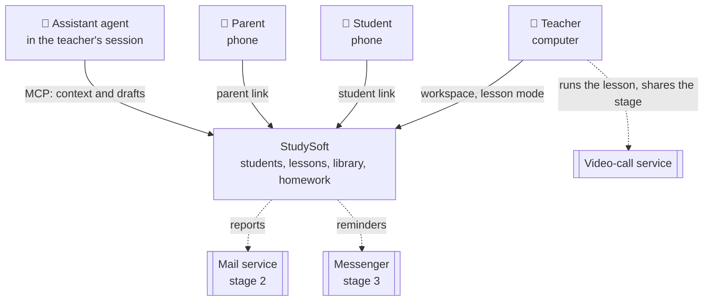
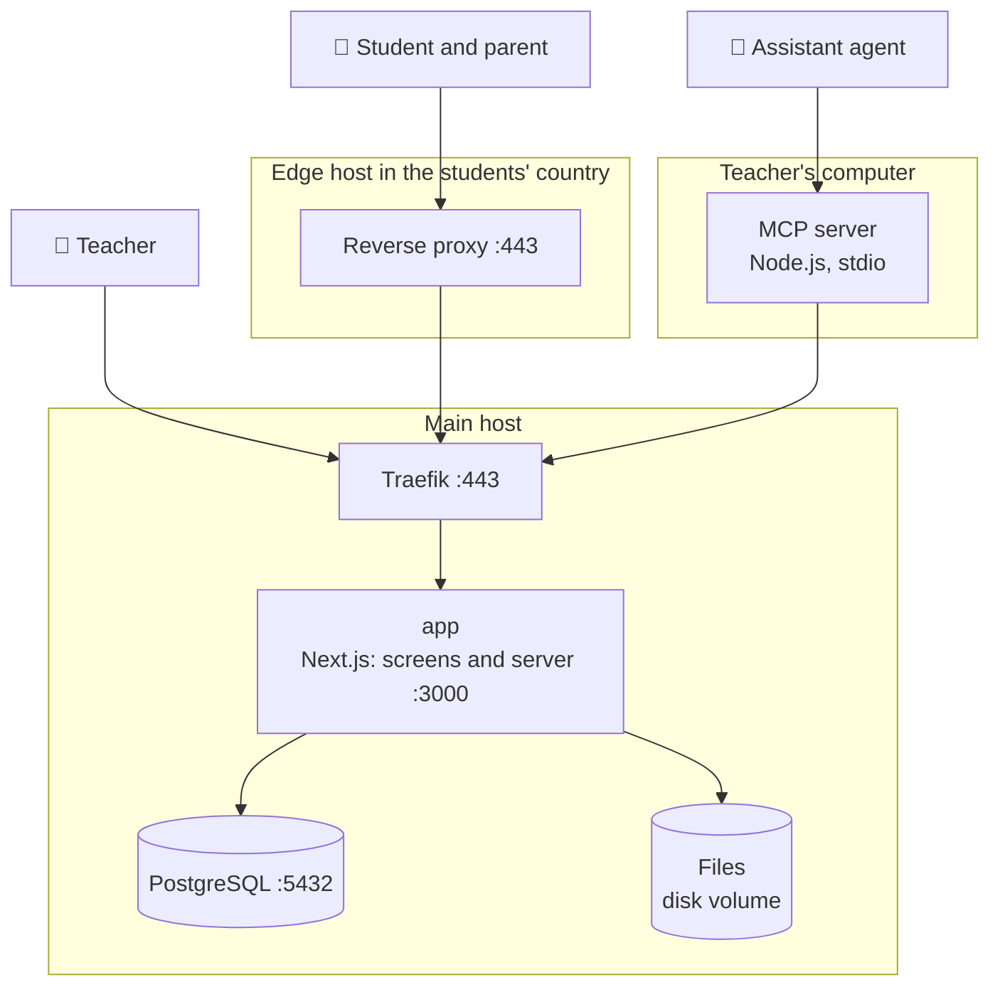
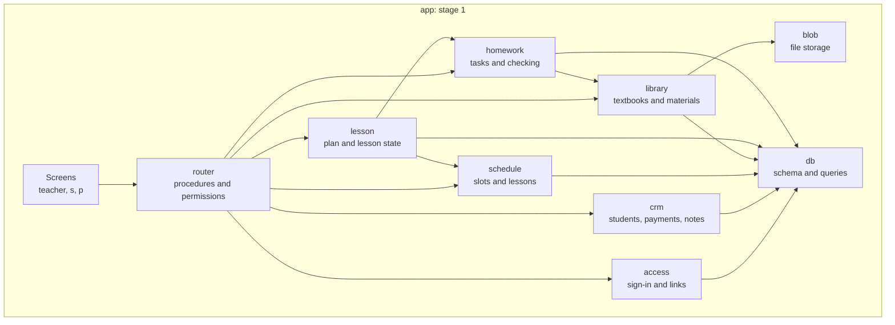
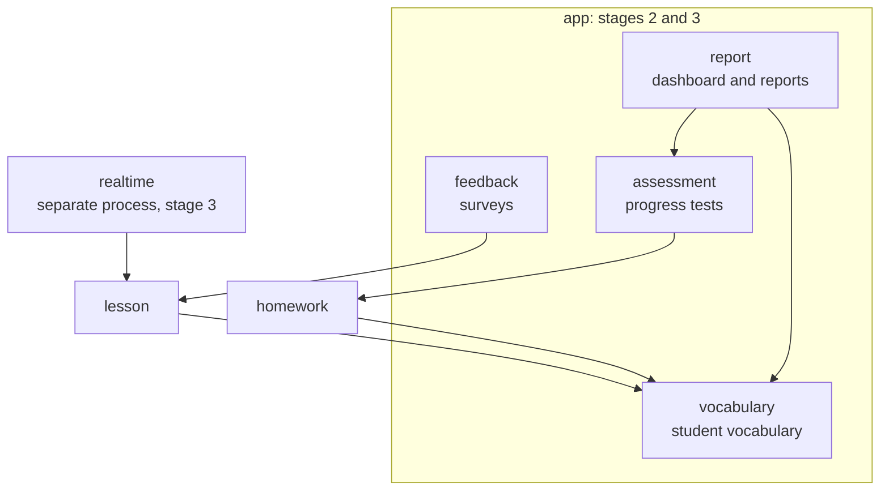
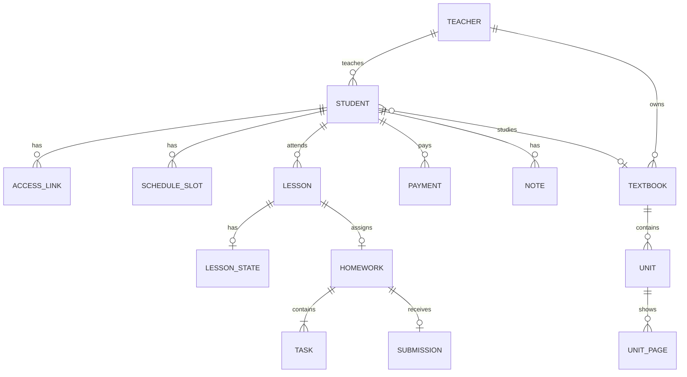
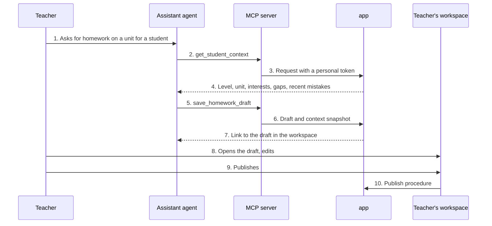
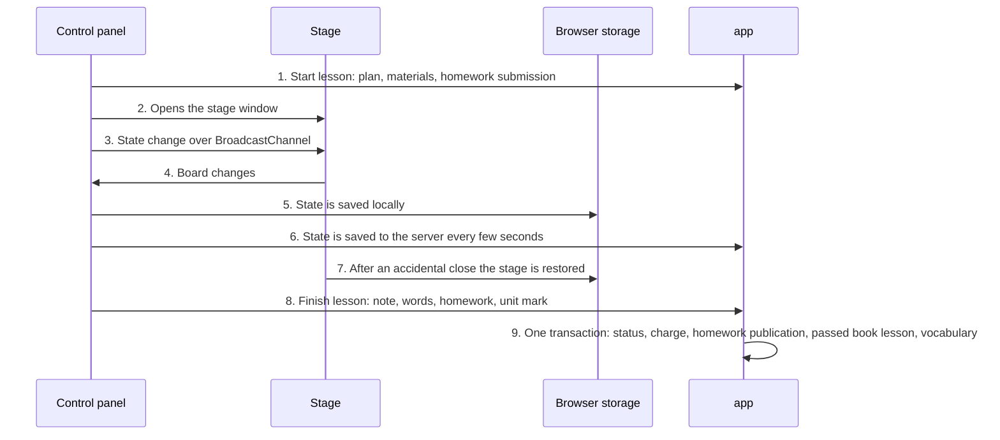
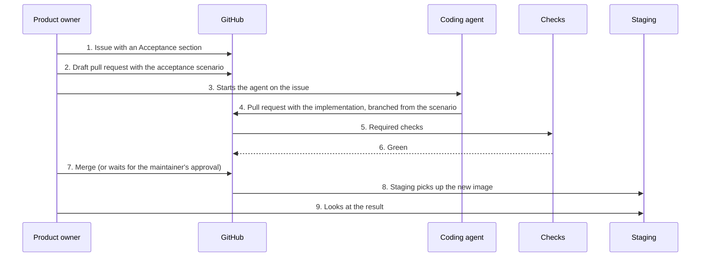
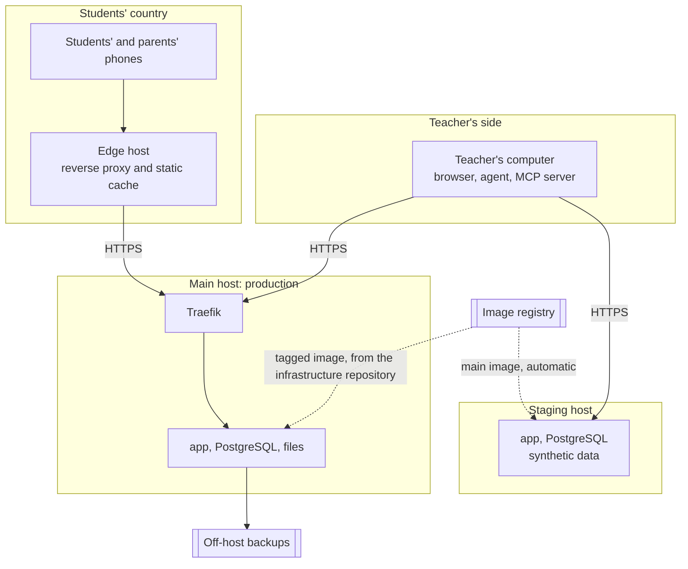

# StudySoft — Architecture

## Overview

StudySoft is a web platform for a private language tutor. It keeps everything around a lesson in one place: students and payments, the schedule, a library of learning materials, a lesson mode, homework with automatic checking, and — in later stages — a personal vocabulary, progress assessments and reports for parents.

The architectural style is a modular monolith in TypeScript: one Next.js application whose screens are separated from the server layer by a typed router, on top of PostgreSQL. AI is not built into the server. Drafts are prepared by an AI agent running in the teacher's own session and handed to the platform through an MCP server.

This document has two readers. One is a person who needs to understand how the system is put together and why. The other is a coding agent that implements tasks and must stay inside these boundaries.

Status: target architecture. The repository holds the foundation; application code arrives in vertical slices. Product requirements live in [docs/product/](product/README.md).

---

## 1. Goals

### 1.1 Requirements

**Business:**

- The teacher's time is the lesson. Preparation, homework, checking and reports are semi-automatic: AI prepares a draft, the teacher reviews and edits it.
- Sections are connected. The textbook on a student's card determines lesson materials, homework, vocabulary and assessments. Data is entered once.
- Scale: one teacher and a handful of students now; about ten students and small groups of up to four within a year; several teachers later.
- The code is open, learning content is not. Materials, games, exercises and tests are created by the teacher, alone or with an agent. They are stored as data, not code, and can be exported.
- The product owner should be able to run the project without a developer on call. The development process is therefore as much a part of the architecture as the code.

**Functional, by stage:**

| Stage | Scope |
|-------|-------|
| 1 (core) | Teacher sign-in; student cards, notes, payments, lesson history; schedule with recurring slots and two time zones; library with textbooks split into units; two-window lesson mode with a board; homework with automatic checking behind a student link; access links for the student and the parent (the parent page is a read-only shell until stage 2) |
| 2 | Student vocabulary, assessments, dashboard, teacher overview, parent dashboard and reports, student feedback |
| 3 | Mascots and game elements, messenger notifications, lesson stage behind a student link, shared board, group interface, accounts for other teachers |

**Non-functional:**

- Everything a student or parent opens works from their country without a VPN and without accounts at foreign services.
- Student screens are built for a phone; teacher screens for a computer at 1280 px and wider.
- Switching material on the lesson stage takes no more than 0.5 seconds.
- Time is stored in UTC and shown in the teacher's and the student's time zones.
- Textbook files are available to the teacher only.
- AI output is always saved as a draft and never reaches a student without the teacher's confirmation.

### 1.2 Quality goals

The order is the priority: when goals conflict, the higher row wins.

| Priority | Goal | Measured by |
|----------|------|-------------|
| 1 | **Verifiable changes** | No change reaches `main` without green required checks; the behaviour of every task is pinned by an acceptance scenario |
| 2 | **Protection of children's data** | Tenant isolation and link scope tests pass on every pull request; logs contain no names or tokens |
| 3 | **Availability for students** | A student link opens without a VPN; the first homework screen appears within 3 seconds on mobile data |
| 4 | **Owner autonomy** | Most tasks go from an issue to staging without the maintainer |
| 5 | **Low cost** | No new monthly server bills in the first months |
| 6 | **Room to grow** | Groups, a second teacher and the stage behind a student link are added without reworking the data model |

### 1.3 Stakeholders

| Role | Expects |
|------|---------|
| Product owner (also the teacher, also acceptance) | The platform saves time around the lesson; she runs the backlog, starts the coding agent and accepts work by behaviour |
| Maintainer (architecture, review, operations) | The guardrails hold without constant involvement; approval is needed only for changes in dangerous places |
| Student, 12–15 years old | Opens a link on the phone and does the homework, no registration |
| Parent | Sees the child's progress behind a link, configures nothing |
| Coding agent | Clear rules, a working example to follow, fast feedback from checks |
| Teacher's assistant agent | Reads student context and saves drafts through MCP |

---

## 2. Constraints

### 2.1 Technical

- **Language**: strict TypeScript for everything: screens, server, MCP server, tests. One language is what lets the product owner read the project.
- **Framework**: Next.js and React, dictated by the board, the game-like homework and the lesson mode.
- **Database**: PostgreSQL, one for everything.
- **Client–server boundary**: screens get data only through the typed router. Components have no direct access to the database or server modules.
- **AI**: the server does not call models. Model provider APIs are not available from every region, and a separate API key is a separate cost.
- **Student and parent pages**: no external fonts, analytics or embedded players. Everything a page needs is served from the application's own domain.

### 2.2 Organizational

- **Team**: the product owner writes acceptance scenarios and runs tasks, agents write code, there is one part-time reviewer.
- **The product owner does not read code yet.** Whatever must hold is checked automatically, not by review.
- **The reviewer is stronger on the server than in React.** Complex screens are verified by acceptance scenarios, not by reviewing markup.
- **The repository is public.** It contains no learning content, no student data and no secrets (section 8.9).
- **Tool neutrality**: agent instructions live in `AGENTS.md`; names of specific AI tools do not appear in code or comments. Attribution lines in commits and pull requests are allowed.
- **Whole structure first.** The product owner wants every section to exist in a basic form before any is polished. The architecture answers with vertical slices: each section first appears thin but end to end.

### 2.3 External

- **Personal data**: data about children and parents is personal data. The platform stores the fields the product requirements ask for (decision 6 in section 9); how much it holds is a known risk (section 11). Legal requirements on where data is stored are met by the deployment.
- **Textbook copyright**: textbook files are visible to the teacher only and have no public links. A student receives only what the teacher included in homework.
- **Characters**: original only, uploaded by the teacher.
- **Video calls**: an external video-call service. The platform stores only the meeting link.
- **Blocking**: foreign services and addresses may be throttled in the students' country without notice. Any third-party dependency of a student page is a risk.

---

## 3. Context and scope

### 3.1 System context (C1)



A solid line is a connection that exists in stage 1. A dashed line is either a connection without integration (the video call) or one that belongs to a later stage.

### 3.2 Technical context

| External party | Protocol | Purpose |
|----------------|----------|---------|
| Teacher's browser | HTTPS | Workspace, lesson mode, file uploads |
| Student's and parent's browser | HTTPS through a reverse proxy in their country | Homework, vocabulary, reports |
| Assistant agent | MCP over stdio to a local program, then HTTPS with a personal token | Reading student context, saving drafts |
| Video-call service | No integration | The teacher pastes the meeting link |
| Mail service (stage 2) | SMTP or HTTP API | Sending a report to a parent |
| Messenger (stage 3) | Bot API | Reminders |
| GitHub | Git, Actions, image registry | Code, checks, image builds |

---

## 4. Solution strategy

### 4.1 Architectural approach

| Approach | Why |
|----------|-----|
| Modular monolith | One teacher and a dozen students do not justify a distributed system. Modules with explicit boundaries give the same order without network calls between them |
| One language | A slice passes through one layer of types from the database to the screen, with no code generation. Agents are most reliable on this stack, and acceptance scenarios are written in the language of the product |
| The router is the only door to data | In Next.js the client–server boundary is blurry: a component can technically read the database. The rule "data only through the router" restores an explicit boundary, and a CI check keeps it |
| Walking skeleton and vertical slices | Agents extend an existing pattern well and invent a consistent one from scratch badly. The first slice goes through every layer: teacher sign-in, a student, a link, a student page, a deployment |
| AI as an external actor | The assistant agent runs on the teacher's side and sees the platform through a narrow set of MCP tools. It creates drafts only; the teacher publishes |
| Content is data | Games, exercises, tests, tasks and the teacher's own method notes live in the database and file storage, not in code. The code can be open without exposing materials, and a new material needs no release |
| Events as explicit commands | Every domain event ("lesson finished", "homework submitted") is one function of a server module in one transaction. The consequences of an event are not scattered across screens |
| Derived values are not stored | Balance, homework completion rate and textbook progress are computed from source records |
| Lesson state is a document | What is on the stage, the page, the player and the board are described by one document that does not depend on how it is delivered. Today it travels over BroadcastChannel, later over WebSocket |
| Acceptance scenarios as the behaviour boundary | The product owner knows how to test. A Playwright scenario is her way to say "it must work like this" and to verify it without a reviewer |

### 4.2 Technology

Libraries marked "candidate" are confirmed when the skeleton is built: the current version and its maintenance are checked first.

| Aspect | Choice | Why |
|--------|--------|-----|
| Language | TypeScript, strict mode | One language for screens, server, MCP and tests |
| Framework | Next.js 16, React 19 | Current stable versions; standalone output gives one small image |
| Server layer | tRPC and zod | Procedure types reach the screen without code generation; input is validated at the boundary; permissions are set per procedure |
| Database access | Drizzle ORM | The schema is described in TypeScript, queries stay close to SQL and are readable in review |
| Migrations | drizzle-kit, SQL files in the repository | A migration is visible to the eye; a migration linter, squawk, catches destructive changes and missing lock timeouts |
| Teacher sign-in | A ready-made library: Better Auth | Authentication code is not written by agents; sessions live in the database |
| Client data | TanStack Query on top of the tRPC client | Caching and retries without hand-written code |
| Styling | Tailwind 4, Radix, Lucide icons | Design tokens map to CSS variables |
| Forms | react-hook-form and zod | The same validation schemas on the client and the server |
| Board | A simple board of our own (#155): text in the chalk font, chalk lines and a sponge as SVG, sheets with one step back; the chalk font is Pangolin from `@fontsource/pangolin` (OFL), served with the app | Excalidraw was the candidate (part B of #7); the board needs printed text, a few colours, sheets and undo, which a small component of our own covers without a large dependency, and it looks like a chalkboard by construction. Excalidraw stays the option if collaboration or shapes are needed later |
| Textbook pages | PDF pages rendered to images on the server with a poppler utility | Deterministic and AI-free; pages open instantly during a lesson |
| MCP server | The official TypeScript SDK, stdio transport | A thin wrapper over the same router; types are shared with the application |
| Acceptance tests | Playwright | Direct successor of Selenium, a model the product owner already knows |
| Unit and integration tests | vitest, real PostgreSQL in Docker | One tool for both levels |
| Packages | npm workspaces | Ships with Node.js: nothing extra to install |
| Build and run | Docker Compose, Makefile | One command in every environment |
| Proxy | Traefik | Already in use on the hosts |
| CI | GitHub Actions | Free for a public repository |

---

## 5. Building blocks

### 5.1 Containers (C2)



Ports are planned values; they become checkable once `deploy/compose.yaml` exists. Only Traefik is published; `app` and PostgreSQL are reachable only inside the internal Docker network.

The application is one container and one image. The teacher and the MCP server talk to the main host directly; students and parents go through a proxy in their country. The reasons are in section 7 and decision 7 in section 9.

### 5.2 Application modules (C3)



Modules of later stages attach to the same points:



Dependency rules:

- Screens talk only to the router. This holds for client and server components alike: a server component calls the same router, so permission checks always run.
- Arrows between modules point down only and go through a module's public functions. A module does not read another module's tables.
- There are no cycles. If a module needs data from a neighbour "upwards", that is a reason to move the event into a function of the upper module.

### 5.3 Responsibilities

| Module | Responsible for | Depends on |
|--------|-----------------|------------|
| Screens | Display and input. No business logic, no data access | `router` |
| `router` | Procedure definitions, input validation, identifying the caller, mapping errors to codes. No business logic | All modules |
| `access` | Teacher sign-in; issuing, checking and revoking student and parent links; personal tokens for MCP; the "who sees what" rule | `db` |
| `crm` | Student card, contacts, statuses, notes, payments, balance, lesson price history | `db` |
| `schedule` | Recurring slots, creating lessons ahead, rescheduling and cancelling, time zones | `db` |
| `library` | Textbooks, files, units, page images, games, warm-ups, videos; textbook parsing and its confirmation; export and import of materials | `blob`, `db` |
| `lesson` | Lesson plan by stages, stage state, the "finish lesson" command with all its consequences | `schedule`, `homework`, `db` |
| `homework` | Homework, task types, draft answers, single attempt, automatic checking, manual review | `library`, `db` |
| `assessment` | The monthly skills assessment: its format, the draft on the card, its files and approval (#252) | `blob`, `db` |
| `blob` | The `BlobStore` interface: put and read a file by id, and remove it. A large file is written as it arrives, stopping at a limit, and read in byte ranges, never held whole in memory (#117). A `file` adapter in the `FILES_DIR` directory now, `s3` later. Who may read a file is decided by the caller | Disk |
| `db` | Schema, migrations and transactions; every query takes the teacher identifier | PostgreSQL |

Repository layout:

```text
app/
  src/app/teacher/     teacher's workspace
  src/app/s/           screens behind a student link
  src/app/p/           screens behind a parent link
  src/app/api/         entry points: router, files, /api/healthz
  src/server/<module>/ server modules from the table above
  src/server/router/   procedures, grouped by who may call them
  src/server/db/       schema and migrations
  src/components/      shared interface components
mcp/                   MCP server and instructions for the assistant agent
e2e/
  acceptance/          acceptance scenarios written by the product owner
  smoke/               smoke checks for a deployed environment
deploy/                compose files, image build, seed data
docs/                  this document
scripts/ci/            guard scripts run by `make check`
AGENTS.md              rules for coding agents
Makefile               single entry point for every command
```

### 5.4 Data model

The core of stage 1.



| Entity | Owning module | Retention | Notes |
|--------|---------------|-----------|-------|
| `teacher` | `access` | Permanent | Account and settings: time zone, cancellation rule |
| `student` | `crm` | Permanent, soft delete | Profile fields as in [the product requirements](product/modules.md): first and last name, status, age, school year, time zone, level, interests, gaps, textbook and current unit; the family's goal and a personal measure — a name and a unit of the teacher's own (#266), teacher only, not in the assistant's context |
| `contact` | `crm` | Until consent is withdrawn | The parent's and the student's contacts, as in the product requirements: one row per student, all fields optional; read by teacher procedures only, never by student, parent or agent ones (#84) |
| `access_link` | `access` | Until revoked | Who, role (student or parent), generation, token hash, revocation date; one per student and role. `link_session`: cookie hash, generation, sliding expiry |
| `schedule_slot` | `schedule` | Permanent | Weekday, local time and the student's time zone, duration, validity dates (#80). Changing a slot from a date ends it the day before and starts a new one (#81) |
| `lesson` | `schedule` | Permanent | Type (regular or introductory), time in UTC, duration, status, the slot and the student's date it came from; the mark (#82): held or missed, whether it is charged, the unit covered, a note and, for a held lesson, the number for the student's personal measure (#266), kept on the lesson so the note never joins the notes the assistant reads, and erased from all the student's lessons when the measure's name or unit changes, in the transaction that saves it with the student's row locked: another measure starts from zero (#279); cancelled, charged or not, and when it was first planned if it was moved, plus its own meeting link (#81); later the plan by stages. Lessons are created from slots 4 weeks ahead whenever the week is read or a slot or status changes; one per slot and date (#80) |
| `lesson_plan` | `lesson` | Permanent | The preparation of a lesson (#151, `domain/lesson-plan.ts`): the approved plan by stages — a book lesson of the student's textbook with the exercises to skip, a warm-up, a game or a video from the library, or the review of a submitted homework (#153), each with minutes — which makes the lesson «подготовлен»; the assistant's draft beside it, which only the teacher approves (her save is refused when the draft changed since her page loaded it); and the homework draft prepared for the lesson, published later by «Завершить урок» (#154). The student's textbook (`student.textbook_id`) and the lesson of it passed so far come from the card, or from the book lesson in the plan of the latest held lesson, whichever is later; «Подготовка» proposes the lesson after it. A homework waits for review when it is the student's latest submitted one and was submitted after their latest held lesson ended; its stage comes first in the plan the preparation shows, and «Запустить урок» adds it to the approved plan unless the teacher last saved the plan after the submission (she saw it then and removed it; `updated_at` is her last save, the assistant's drafts leave it as it was). In «Домашка к уроку» the confirmed bank tasks of the plan's book lessons are shown as the child will see them; «Собрать домашку» copies the checked ones, with their stored files' references, to the end of the draft chosen for the lesson, the draft locked while it grows, or into a new draft «Домашка: урок X.Y», and attaches it; the bank as the page showed it is checked by its revision, and a later edit of the bank leaves the built homework as it was (#226) |
| `lesson_state` | `lesson` | Until the lesson is finished, then a snapshot | Stage state document (#152, `domain/lesson-state.ts`): the stages, the current one, each book stage's book and page, each homework stage's filter («Все задания» / «Только ошибки») and the tasks whose right answer the teacher has shown (#153), the layout and the track; `revision` is the panel's own counter, and a save is written only when it is newer than the kept one, so a late save never replaces a newer state. Beside it the teacher's note to the lesson, which never travels to the stage. The words the teacher notes on the panel, «Слова урока» (#154), are part of the state. The chalkboard (#155) is part of it too: its sheets — printed text and chalk and sponge lines in the sheet's own coordinates, at most 20 sheets of 300 items — the current sheet, and per sheet what its last change took, for «Вернуть». The teacher draws in the stage window, which sends the board to the panel; the panel keeps it like any change. A lesson starts with a clean board of one sheet. «Доска крупно» on the panel (#205), `boardLarge`, spreads the board over the whole stage, the sheet and its text scaled up. «Завершить урок» offers every printed line of every sheet with a checkbox (#206); a checked line goes to the vocabulary with the panel's words, «word — translation» split at the first dash, equals sign or colon |
| `vocabulary_word` | `crm` | Permanent | The student's vocabulary (#154): one row per word regardless of case (a unique index on `lower(word)`), with its translation and example sentence if any and the lesson it came from. Written by `finishLesson`, where a later lesson fills in a missing translation, and by the teacher on the card, who adds, corrects and deletes words (#236); the same word in another case is refused. The assistant proposes a translation and an example as the word's draft (`draft_translation`, `draft_example`, #237: `agent.saveWordDrafts`, every word the student's or nothing saved); the student never sees a draft, and the teacher's «Подтвердить» or «Подтвердить все» makes it the word's translation and example, conditional on the drafts her page showed, an empty part keeping what was confirmed. The teacher sees it on the card («Словарь»), the assistant in the student context (the newest 300 words), the student in «Тренировка слов» behind their link (#236: their own words only, searched on the page, «Послушать» by the browser's speech synthesis, nothing sent anywhere). The daily training (#238, `domain/word-training.ts`, `crm/word-training.ts`) keeps its progress on the row: `train_step`, the right answers in a row on days the word was due; `due_on`, the student's date it is due again (none: new); the counts of right and wrong answers and the last one. Today's words are those with a translation that are due in the student's time zone, at most 15, one exercise each, easiest first for a new word; an answer is checked on the server and moves the word to 1, 2, 4, 8 or 16 days on, or back to tomorrow from the start when wrong, with a write conditional on the state it was checked against. «Ещё разок» and a word answered again the same day move nothing but a mistake. Five right on different days: learnt. The card marks each trained word «закрепилось» (learnt), «часто ошибается» (more mistakes than right answers so far) or «учится», and counts the learnt ones with the day of the last training; the student context gives the assistant the words often missed, `weakWords` (#240). «Из словаря» in a homework draft (#281, `domain/vocabulary-homework.ts`, `crm/vocabulary-homework.ts`) offers the words with a translation, the last lesson's and the often missed ones ticked, at most 12; the teacher's page builds matching and choice-of-translation tasks, a gap in the word's confirmed example where it uses the word as it is, and the word written from its translation (#283), with their keys and saves them as any edit of the draft. Each such task names its words in the task's `vocabularyWords`, which a save keeps only for this student's words still among the task's answers — the word or its translation (#284) — and the student never receives. On «Сдать», in the submission's transaction, a word of a task answered wrong (in a matching task, of its own wrong pair; a task left unanswered, all) counts one mistake, starts again from the first interval and is due tomorrow in the student's time zone unless due by then already; a right answer moves nothing, so «закрепилось» comes from the training only. A word missed in homework is marked «часто ошибается» before its first training too |
| `skill_result` | `crm` | Permanent | A student's result by skill (#255): a percent on a date, one per skill and date, entered by the teacher on the card («Внести результаты») until the monthly assessment's format is decided; the assessment will write the same rows (#252–#254). Saving a date replaces its results in one transaction, a changed date moves them. «Прогресс» on the card shows each assessed skill by month, the latest result of a month as its point, with growth or slip against the point before, beside the homework submitted of those due, the units passed and the words learnt (`crm/progress.ts`). The parent's page shows the same dashboard by `parent.progress`, whose output schema carries nothing else (#256). No student procedure reads it |
| `report` | `crm` | Permanent | A parent's report (#267): the period in the student's dates — from the day after the last published report to today, the first over the last 30 days — the teacher's blocks of text as JSON (a title and a text each, in her order; four offered: `domain/report.ts`), whether the messenger text carries the balance line, and the status. At most one draft per student, kept by a partial unique index, so two «Новый отчёт» never make two. A draft's numbers — skills in the period against the latest before it, the personal measure, lessons, homework due in the period, words, the textbook — are counted whenever it is shown (`crm/reports.ts`); «Опубликовать» freezes them in `numbers` at the first publishing and shows the report on the parent's page by `parent.reports`, whose output carries the period, the frozen numbers and the filled blocks only (#268); the teacher may edit a published report's text in place, or «Снять с публикации» makes it a draft again, its numbers still frozen — refused while the student has another draft. Two recordings, «было» and «стало» (#269), refer to blobs: the teacher uploads each with `PUT` to `/api/files/reports/<report>/before` or `/after` (MP3, M4A, WAV or OGG by their first bytes, at most 20 MB) and removes it with `DELETE`; the same address serves it, in byte ranges and revalidated by `ETag`, to the teacher and, once the report is published, to the student's parent; anyone else gets the same 404. The balance line goes only into the text the teacher copies, never to the parent's page (rule 4 in `AGENTS.md`). Never a student's |
| `client_request` | `crm` | Until the teacher deletes it, then an anonymous count | A request of a family that may become a student (#337), in «Привлечение клиентов» (`crm/requests.ts`): the child's first name, age and school year, the parent's contact, the source (Профи.ру, Авито, лендинг, соцсеть, другое) and the date, today in the teacher's time zone by default. The stage — «Заявка», «Вводный записан», «Вводный проведён», «Оффер отправлен», «Отказ» — is moved by the teacher, to any stage forward or back; «Отказ» keeps a reason from a list and an optional comment, and leaving it clears both. «Удалить заявку» erases the name, age, school year, contact and comment in the row and sets `deleted_at`: the stage, source, reason and date stay as an anonymous count for the metrics (#341). «Стал учеником» comes with #340. The teacher's only |
| `assessment` | `assessment` | Permanent | The monthly skills assessment (#252): the document in the assessment format (`docs/assessment-format.md`, `domain/assessment-format.ts`) with its keys — up to six sections, kept in the order «Аудирование», «Чтение», «Грамматика», «Лексика», «Письмо», «Говорение» — its title and status, a draft or approved. The teacher imports it on the card («Замеры»); `teacher.assessments` returns it as the child will see it (`assessmentView`), never the keys. The teacher's page carries the revision of the document it shows (an md5 of its jsonb text, as for homework, #99), and both actions on a draft send it back, refused «Замер изменился» when the draft changed since, so she approves only what she has seen (#313): «Убрать» removes a question of «Аудирование», «Чтение», «Лексика» or «Говорение», a write conditional on the document it read and on the draft still being a draft; «Утвердить» is one statement that wants a draft of that revision with its recording when it has «Аудирование», and nothing changes after it. Two files refer to blobs: the recording for «Аудирование» and the picture for «Говорение», uploaded by the teacher with `PUT` to `/api/files/assessments/<id>/listening` or `/picture` while a draft (MP3, M4A, WAV or OGG up to 10 MB, PNG, JPEG or WebP up to 2 MB, told by their first bytes) and removed with `DELETE`; the same address serves them to the teacher only, anyone else the same 404. A «Лексика» question may name a word of the student's vocabulary (`vocabularyWord`), kept only when the word is the student's. The assistant saves a draft with `agent.saveAssessmentDraft` (#313), at most 200 000 characters of JSON like the teacher's import, marked `created_by = agent` and shown «от ассистента»; its `context` keeps only the `assessmentPeriod` it was drafted from, as long as the assessment, never the rest of the student context (notes, results, interests stay where the teacher can delete them); the teacher's first action on a draft — a removal, the recording or the picture, uploaded or removed — sets `teacher_edited_at`, and the assistant's save is one statement that replaces its latest draft only while that is unset, so a save that waited for her action makes a new draft and keeps hers. The context's `assessmentPeriod` runs from the last approval (the last 30 days without one) and carries the lessons of the student's textbook finished in it — a held lesson's unit only when it is one of the textbook's lessons, as «Завершить урок» writes it, never what the teacher typed when marking (#82) — and the words added in it. No student or parent procedure reads it yet (#253) |
| `payment` | `crm` | Until the teacher deletes it | Date, amount in minor units, comment. The balance is computed, not stored: payments minus charged lessons, each at the price of its date (#83). The teacher corrects or deletes one from the card (#101) |
| `payment_revision` | `crm` | 30 days: `npm run payments:cleanup -w app` removes older rows. It runs nightly within `npm run cleanup:nightly -w app`, which the server's scheduler starts before the backup (#165) | A payment's date, amount and comment before an edit or a delete, and which it was (#101). Shown nowhere; kept in case a correction was itself a mistake |
| `price_terms` | `crm` | Permanent | The payment format (prepaid, postpaid, free), the lesson price and its currency (₽, $, €, ฿; one per student), in force from a date; a new row starts new terms and earlier lessons keep theirs. The card shows the balance for prepaid students, only a debt for postpaid ones, nothing for free ones (#83) |
| `price_history`, `level_history` | `crm` | Permanent | History of the lesson price and the level: past charges are never recomputed |
| `note` | `crm` | Permanent; the teacher may delete one | Attached to a student (#42); a lesson's note is kept on the `lesson` row instead (#82), so it never joins the notes the assistant reads. A composite key to `student (id, teacher_id)` keeps it inside one teacher. Teacher only |
| `textbook`, `textbook_file`, `textbook_page` | `library` | Permanent | A set with a title and a level, and its units and lessons as two JSON documents in `textbook` (#150, `domain/textbook-structure.ts`): the confirmed `structure` lessons use, and a `structure_draft` — the assistant's, which it may replace, or the teacher's own edits, which it may not — that confirming replaces it with; the teacher's save is refused when the draft changed since her form loaded it. Each lesson has an id that stays across edits, its page ranges in each book, its tracks by name and its words; a structure is checked against the set's rendered pages and tracks; its files — the student's book and the workbook (PDF, at most 300 MB each) and the tracks (MP3, M4A, WAV or OGG, at most 500 MB together) — uploaded with `PUT` to `/api/files/textbooks` and written to the store as they arrive; each book's pages rendered in the background with poppler's `pdftoppm` to JPEG and kept one blob per page. A book's status is queued, rendering, done or failed, with the server process that took it: one left by a process that stopped reads as failed and is tried again with «Повторить». A book or a track is served at `/api/files/textbooks/<file>` in byte ranges and a page at `/api/files/textbooks/<file>/pages/<n>`, to the teacher only; anyone else gets the same 404 as for a missing one (#156) |
| `textbook_lesson_tasks` | `library` | Permanent | The task bank (#224): one row per lesson of a textbook's confirmed structure (`lesson_id` is the lesson's id inside `textbook.structure`, not a foreign key), with its tasks in the homework format, each with its `source`, and the exercises that did not become tasks with their reasons. `tasks` and `skipped` are the confirmed lesson; `draft` and `draft_skipped` the assistant's latest save (`agent.saveTextbookLessonTasks`, checked against the format and the confirmed structure), which replaces them only on the teacher's «Подтвердить урок». «Убрать» and «Подтвердить урок» are conditional writes on the draft as her page showed it, so a draft the assistant replaced meanwhile is a conflict, never confirmed unseen. Pictures and recordings are kept in the blob store as a homework keeps them and served at `/api/files/bank/<row>/<tasks\|draft>/<task>` (`/audio`, `/pictures/<n>`) to the teacher only; anyone else gets the same 404. The teacher sees each task as the child will, without the keys; a confirmed task opens whole in the homework draft's task editor and is saved back into the bank, a conditional write on the lesson's confirmed tasks as her editor loaded them (#225). No student, parent or link procedure reads it. A lesson the structure no longer has keeps its row, unseen, until a structure brings the lesson back. The keys of the teacher's book, as `answer_key`, are not stored yet |
| `library_item` | `library` | Permanent, soft delete | Game or trainer (self-contained HTML), warm-up, video, test template, the teacher's method note. Author's content: included in backups and export |
| `homework`, `task` | `homework` | Permanent | The document in the homework format (`docs/homework-format.md`), stored as imported. Statuses: draft, published, submitted ("сдана", #34), missed ("не сдана"). Tasks do not change after publishing; a deadline is a calendar date; at most one published homework per student, kept by a partial unique index |
| `homework_submission`, `homework_answer` | `homework` | Permanent; voice recordings per the retention setting | One submission per attempt, with its idempotency key and score; one current submission per homework (a homework belongs to one student), enforced by a partial unique index. «Открыть заново для ученика» closes the current one, which stays in the history as it was, and starts a blank attempt (#36). One answer row per task and attempt: saved as the student goes (a written answer as its text, a recording or a file as a reference to its blob, #35), and on submission every task gets one with its topic and skill, the platform's correctness for auto-checked tasks, and later the teacher's mark, which wins (#34, #36). An order task of several sentences keeps each sentence's result and mark in `sentence_verdicts`; each sentence is one point of the score (#161) |
| `homework_feedback` | `homework` | Permanent, like the homework | «Мини-вопрос после домашки» (#331, `homework/feedback.ts`): a homework draft has `ask_feedback` on `homework`, off by default, the assistant's drafts included, set in the publish form and saved by «Опубликовать». With it on, after the first «Сдать» of a homework of more than one kind of task the child sees «Какое задание было самым интересным?» with the kinds of its tasks in the child's words (`CHILD_TASK_KIND_LABELS`) and «Все классные», or «Пропустить» — not after «Открыть заново для ученика», and a homework of one kind asks nothing (product owner, 2026-11-23). One row per homework: the kind, `all`, or null for a skip, written by one statement conditional on the homework still being asked, so one reopened in between gets none. It counts for nothing: not the score, not the homework's statistics. «Фидбэк» on the card lists the answers with the homework and the date (`teacher.students.feedback`); `student.homework.miniQuestion` gives the child the kinds only, and no student or parent procedure returns an answer |
| `homework_survey` | `homework` | Permanent, like the homework | The survey about the lessons sent with a homework (#332, `homework/survey.ts`, `domain/survey.ts`), when the teacher ticks «Опрос по урокам» in its draft, off by default. Ticked, it gathers its questions from the lessons held in its period — from the end of the student's previous survey sent, at most two weeks back; the first over the last week — and keeps the period: «Что было веселее: A или B?» for pairs of the plans' materials in order (at most three), «Про что хочется ещё?» between the topics of those materials and of the homework published in the period (at most three, product owner 2026-11-23), «Насколько понятно: <тема>?» per topic with three faces, and «А ещё я хочу…» last; with no lesson held, nothing, and the box says so. The teacher removes questions and adds her own, answered with text, as conditional writes on the questions her page showed. The box and every edit lock the draft's homework row, as «Опубликовать» does, so a change lands before the publication and opens with it, or finds the homework published and is refused; the page keeps «Опубликовать» waiting while a change is saved. «Опубликовать» opens it with the homework, unless every question was removed: then it goes, and the child is asked nothing; «Снять с публикации» takes an unanswered one back to the draft. On the child's page it comes first, above the homework, until «Готово» (any question may be left unanswered) or «Пропустить», one conditional write on it still being open. It counts for nothing. «Фидбэк» on the card lists the answered surveys question by question (`teacher.students.surveyFeedback`); the child gets the questions only, the parent nothing |
| `imported_submission`, `imported_answer` | `homework` | Permanent | The results history from the teacher's old tool (#38, `docs/history-import-format.md`): one submission per student, date and homework title, kept by a unique key so a second upload adds nothing, with the score counted from the results; one answer row per task with its text, type, topic, the answer, the key and right or wrong. Read-only: never waiting for review, marked or reopened |
| `blob` | `blob` | With what refers to it: `npm run blobs:cleanup -w app` removes the rows and files that no homework document (a task's picture or recording), task of the task bank (#224), answer, library material, textbook (a book, a track or a page, #156), parent's report (a recording, #269) or assessment (a recording or a picture, #252) of any teacher refers to, once they are 24 hours old, and prints only how many and their size (#73). It runs nightly within `npm run cleanup:nightly -w app`, which the server's scheduler starts before the backup: the schedule is in the private infrastructure repository with the rest of the stack (#165) | Whose file it is, its type and size; the bytes are in the store under the same id. Homework pictures are stored on import and served at `/api/files/homework/<id>/<task>` after a permission check (#33); a task's recording to listen to the same way at `/api/files/homework/<id>/<task>/audio`, answering byte ranges, the same file in several tasks stored once (#127). A student's recording or photo is uploaded with `PUT` to `/api/files/answers/<id>/<task>` by the student's own link session, at most 10 MB and a recording at most 5 minutes, both checked on the server from the bytes; the answer row refers to the file, and the same address serves the current attempt's file to that student and their teacher, revalidated by `ETag` and answering byte ranges (#35). «Проверка домашек» plays and shows them from `/api/files/answers/<id>/attempts/<attempt>/<task>`, the same check for any attempt, current or earlier (#93). The teacher's own video is uploaded with `PUT` to `/api/files/library` and written to the store as it arrives, at most 200 MB, its type (MP4, WebM or MOV) told by its first bytes; the answer is the file's id, which `teacher.library.addVideoFile` then saves with the tags (#117) |
| `library_material` | `library` | Until the teacher deletes it | A material of the teacher's library (#115): a game, a warm-up (#116) or a video (#117); its title, level, topics and age group for the filters. The topics (#290, `topics`) are typed into «Тема» separated by commas, at most 10 of 100 characters, a repeat in another letter case kept once; the filter offers every topic in use and finds a material by any of them. The single `topic` column of before is copied into the list and no longer used, until it is dropped (#299). A game may be linked to one lesson of the teacher's textbook (#291, `textbook_id`, `textbook_lesson_id`: the lesson's id inside the confirmed structure, `library/lesson-links.ts`), by the teacher in the form or by the assistant in its draft, checked against the confirmed structure; a lesson no longer in it is read as no link. «Библиотека» filters by «Учебник» and «Урок», and the assistant's `textbookStructure` lists each lesson's games. A game may be marked for students of hers (#292, `library_material_student`, `library/material-students.ts`), by the teacher or by the assistant; it stays in the library for everyone. «Библиотека» filters by «Ученик» among her active students; a finished student keeps the mark, a deleted one's is not read; the student context lists the games made for the student, `gamesForStudent`. The student never sees the mark. In a student's lesson prep, «Добавить из библиотеки» offers the games made for that student first, then those linked to a textbook lesson that is a book stage of the plan, then the rest, each group by title (#293, `domain/prep-materials.ts`); the order follows the plan as it is edited. A game, a picture warm-up and an own video keep their file in the blob store; a questions warm-up keeps its questions in the row and has no file; a video link keeps its http or https address and has no file; a video, a link or her own file, may keep the transcript the teacher typed in «Расшифровка» (#326, `transcript`, at most 100 000 characters), which the assistant reads with `agent.libraryVideo` to draft the video's tasks; a game marked as a warm-up is listed under both. A game or warm-up the assistant saves (#120) is a `draft`: it is listed only under «От ассистента» above the library, never in the list, its topics or filters, until the teacher clicks «Добавить в библиотеку». The assistant replaces its draft, by id, with one conditional write while it is still a draft of the same kind and `teacher_edited_at` is empty (her edit sets it); otherwise it gets a new draft. No agent procedure adds a draft or deletes. A draft game is never opened to a student. A file is served at `/api/files/library/<id>` to its teacher only, a game or a video also to a student it is open to (`game_access`, #118, #158), in byte ranges and read in pieces, with `Content-Security-Policy: sandbox`; a game also runs in a sandboxed frame: scripts run in an origin of their own, without the platform's cookies, storage or pages. A YouTube video link (youtube.com/watch, youtu.be, youtube.com/shorts; `youTubeId` in `domain/library.ts`) plays in an embedded player from youtube-nocookie.com on the student's video page and on the video's page in the library (#325); any other video link opens in a new tab |
| `video_tasks` | `library` | With its video | A library video's tasks (#326, `library/video-tasks.ts`): one row per video, gone with it, in the homework format, text only — up to 20 tasks, no pictures or recordings yet. `tasks` are the confirmed ones a student gets (#327); `draft` is the assistant's save (`agent.saveVideoTasksDraft`, checked like an import), which lies beside them and replaces them only on the teacher's «Подтвердить». The save is one conditional write: it replaces the draft while `draft_edited_at` is empty, and the teacher's «Убрать» sets it, so a save after her edit is refused and her draft stays. «Убрать» and «Подтвердить» are conditional writes on the draft as her page showed it (an md5 of its jsonb text), so a draft the assistant replaced meanwhile is a conflict, never confirmed unseen; the last task of a draft stays. The teacher sees each task as the child will, without the keys, in «Задания к видео» on the video's page. No agent procedure confirms or removes; no student, parent or link procedure reads it yet |
| `game_access` | `library` | With its material and its lesson | A game or a video the teacher opened to a student while a lesson of theirs was going on (#118, #158): the student sees a game under «Игры» and a video under «Видео» in «Материалы урока» behind their link (#241: the link opens «Домашка», and the menu marks «Материалы урока» while something is open) and plays it until `until`, one hour after that lesson's end; a video's own file plays on the student's page, a link opens in a new tab. The table keeps its name from #118. One row per game and student; opening it in a later lesson moves `until` on, never back. Written by one statement that reads the lesson, the material and the student, so a lesson not going on (cancelled and missed ones included), a warm-up, a draft or another teacher's material or student never get one; `library` reads only whether a lesson is going on from the schedule's table |
| `game_result` | `library` | Permanent, like the homework answers | A result a game posted in the game result format (`docs/game-result-format.md`) while the student played it behind their link (#119): the answers as text, right or wrong as the game checked them, with topic and skill, and the game's title. Written by one statement that reads `game_access`, so a game not open to this student, after `until` or another teacher's never gets one. A game the teacher runs herself on her page during a lesson keeps its result for the student of the lesson going on, `played_with_teacher`, written by one statement that reads the lesson, the student and the game (#147); a game played on the lesson stage (#199) keeps its result the same way for the stage's lesson and its student, the lesson only having to be still to hold, whatever the clock says; «Ошибки по темам» marks it «Игра на уроке». Every result is kept; the latest per game and lesson counts, whichever way it came. No foreign key to the game or the lesson: the student's mistakes outlive a game deleted from the library. Their wrong answers and those of submitted homework (the latest attempt of each) make one list by topic over the last 30 days, built in `crm` (`crm/mistakes.ts`): «Ошибки по темам» on the student card and `mistakesByTopic` in the student context. A game template's result of version 2 names the word of an answer (#285): a wrong answer on a word of the student's vocabulary brings it back into the word training as a homework mistake does (`missedOutsideTraining`), from every kept result, wherever the game was played |
| `agent_token` | `access` | Until revoked | The assistant's personal token, hash only; one active per teacher; created and last-used dates (#3) |
| `draft_origin` | `homework`, `lesson` | With the draft | Who created the draft (agent or teacher) and a snapshot of the student context at generation time. For homework (#43): one row per assistant draft, and when the teacher first edited it; until then the assistant's next save replaces the draft, after it a new draft is made. The teacher's page carries the revision of the document it shows (an md5 of its jsonb text); publishing and saving tasks from a page older than the draft are refused, so she publishes only what she has seen (#99). Library drafts carry no student context and are marked on `library_material` itself (#120) |
| `group`, `group_member` | `crm` | Permanent | Tables exist from the first migration; the interface arrives in stage 3 |

Rules for every table:

- Every table except shared reference data has `teacher_id`, and every query filters by it.
- Identifiers are UUIDs: `gen_random_uuid()` by default, the built-in `uuidv7()` where rows are ordered by their identifier. Student page addresses carry no identifiers, only a token.
- Physical deletion is forbidden where history refers to the record.
- Entities of stages 2 and 3 (vocabulary, assessments, reports, surveys, characters) are added by the migrations of their own slices. Only groups and `teacher_id` are created up front: they are the only things expensive to add later.

---

## 6. Runtime view

### 6.1 Key scenarios

#### Scenario: a student does homework

```mermaid
sequenceDiagram
    participant S as Student's phone
    participant R as Reverse proxy
    participant A as app
    participant D as PostgreSQL

    S->>R: 1. Opens the link; the token stays in the fragment
    R->>A: 2. Page and static assets (assets from the proxy cache)
    S->>A: 3. Sends the token in a request body
    A->>D: 4. Finds the link by the token hash
    A-->>S: 5. Session cookie; the page clears the fragment
    S->>A: 6. Current homework
    A-->>S: 7. Tasks without correct answers
    S->>A: 8. Saves each answer after every task
    S->>A: 9. Submits with an idempotency key
    A->>D: 10. Stores the submission and checks it in one transaction
    A-->>S: 11. Count of right and wrong answers
```

Step 7: correct answers never go to the client; checking happens on the server only, and a dedicated test pins this. Step 8 gives a draft of answers if the student closes the page. Step 9: a repeated request with the same key returns the earlier result; a second submission of the current attempt is impossible at the database constraint level; a new attempt exists only after the teacher reopens the homework (#36).

#### Scenario: the agent prepares a homework draft



Step 4: the context carries the display name only, no contacts. Step 6: the server accepts only the "draft" status from MCP. Step 10 is available only from the teacher's browser session; the agent's personal token has no right to publish.

#### Scenario: a lesson in two windows and its end



Step 3 does not pass through the server, so switching is close to instant. Steps 5–7 make it possible to close and reopen the stage without loss: the stage and the panel start from whichever of the browser's and the server's states has the larger revision (#152). The stage lives at `/stage/<lesson>`, outside the workspace's layout, so the platform's menu is never on it; it still needs the teacher's session. Step 9 is the `finishLesson` command (#154, `lesson/finish.ts`): either every consequence of "lesson finished" is applied, or none — the homework published (the student's unsubmitted one closed), the lesson held and charged as in #82 with the book lesson as its unit and the note, the passed book lesson set on the student, the book lesson's words and the panel's added to the vocabulary. It locks the homework, the student and the lesson in that order and rechecks that the lesson is still scheduled, so two finishes never both apply. A lesson finished before its time moves to when the lesson mode opened it (`moved_from` keeps the planned moment), so the history shows it. The stage then shows «Урок завершён».

#### Scenario: textbook parsing

```mermaid
sequenceDiagram
    participant T as Teacher
    participant A as app
    participant F as Files
    participant G as Assistant agent
    participant M as MCP server

    T->>A: 1. Uploads the set: student's book, workbook, teacher's book
    A->>F: 2. Stores the files
    A->>F: 3. Renders pages to images
    T->>G: 4. Asks to parse the textbook
    G->>M: 5. read_textbook_text: text layer, page by page
    G->>M: 6. get_textbook_page: page images, for pictures and layout
    G->>M: 7. save_textbook_structure: units, lessons, pages, tracks, vocabulary
    G->>M: 8. save_textbook_lesson_tasks: a lesson's workbook exercises as tasks with keys
    M->>A: 9. Structure and each lesson's tasks as drafts «от ассистента»
    T->>A: 10. Checks the structure and confirms each lesson's tasks; picks tasks for a homework
```

The spike on one real set (#6) confirmed an agent can do it: all 391 pages in one session, the structure of the whole set in about 8 minutes, no errors on unit boundaries, vocabulary or answer keys in the three units checked, and one unit's workbook turned into homework tasks that all passed the format at the first import. It also changed the flow:

- **Text first, images second.** The agent works from the text layer and word coordinates (answer keys and word lists in the teacher's book come in columns); a scanned book needs OCR first, which in the spike ran on the agent's side. Page images serve the pictures and the layout: what is circled, ticked, or drawn. Where OCR runs for a scan uploaded to the platform is decided when the slice is cut.
- **Units are lessons.** A unit is its numbered lessons; review, culture and exam sections between units are lessons of their own, so lesson setup can propose the next one and the teacher can skip one.
- **The result is a task bank, not a structure to correct.** Each workbook exercise becomes a task in the homework format with its key, its instruction, its example and its pictures cut out one by one; the layout (tables, letters, numbering) is drawn by the task's interface. The teacher picks tasks from a unit's bank for a homework rather than checking every item, and sees each one as the student will. What the format still lacks for that is filed as #127–#131.

Step 3 is deterministic and needs no agent; it runs in the background and its status is recorded in the database (#156). Steps 5–7 and the teacher's check of the structure are #150: the structure is a draft «от ассистента» until the teacher corrects and confirms it, and she can enter one by hand. The text layer comes from poppler's `pdftotext` with the layout kept, without word coordinates yet. Step 8 and the teacher's check of a lesson's tasks are #224: on the textbook's page, «Задания» shows each lesson's draft beside its confirmed tasks; she removes what she does not want and confirms lesson by lesson, as she needs them. A confirmed task is fixed in the bank with the homework task editor (#225); «Собрать домашку» in the preparation copies a lesson's confirmed tasks into its homework draft (#226).

#### Scenario: a task from an issue to staging



Step 2 comes before step 4: a scenario written before the implementation checks the task, not whatever code came out. The scenario pull request is reviewed but never merged on its own, because every scenario in `e2e/acceptance/` runs in `make check` and one without its implementation would keep `main` red. Marking it as an expected failure instead would weaken a check. The implementation pull request carries the scenario commit unchanged and supersedes the scenario pull request; `acceptance-unchanged` finds the scenario pull request's branch by the issue number in the branch name and fails if any scenario file it changed — `playwright.config.ts` included, since it decides what runs — differs here from what was reviewed. Step 7: if the pull request touches the database schema, access, dependencies, check configuration, CI or deployment, the merge waits for the maintainer (section 8.4).

### 6.2 Behaviour on failure

- **The reverse proxy is down or its address is throttled.** Students cannot open homework; the teacher keeps working because she connects directly. Monitoring probes availability from the students' country. Recovery: move the proxy to another host, one DNS record changes.
- **The main host is down.** Everything is unavailable. The lesson continues in the video call with materials on the teacher's disk. Recovery: restore from the nightly backup on any host with Docker.
- **The stage is closed or the browser crashes mid-lesson.** State is restored from browser storage, or from the last version on the server if that is lost.
- **A student presses "Submit" twice or the connection drops.** The idempotency key returns the first result.
- **The assistant agent sends a bad draft.** The draft is not visible to the student; the teacher edits or deletes it.
- **The assistant agent is unavailable or out of quota.** The teacher creates homework and the plan by hand in the workspace. A manual path is mandatory for every feature that involves AI.
- **Textbook rendering is interrupted by a restart.** The status in the database stays "not finished"; the teacher restarts it with a button.
- **Invalid input.** Validated at the boundary by the zod schema of the router procedure. A server module receives data that is already validated.
- **A migration fails to apply.** The application does not start with a pending migration; the previous version keeps running.

---

## 7. Deployment

### 7.1 Infrastructure



**Two names on one production.** The teacher's workspace and the student pages have different addresses:

| Name | Points to | Used by | Why |
|------|-----------|---------|-----|
| Workspace name | Main host | Teacher, MCP server | Heavy files and the lesson mode do not take a detour through a third country |
| Student name | Edge host | Student, parent | A local address and a short path to the phone |

The link between the hosts is plain HTTPS; tunnels on that route are unreliable.

The proxy caches only static assets with a hash in the name: scripts, styles, fonts. Router responses and student files are not cached and are served with `Cache-Control: private`.

**Delivery.** CI builds the `app` image and pushes it to the registry: as `main` on every merge, and under its version for every `v*` tag (`v1.2.3` publishes `1.2.3`). The image holds the production build, the migrations and the script that creates a teacher account; it holds no seed data. A stack applies migrations from the same image (`npm run db:migrate`) before it starts the new version. Until #4 is finished the image is not the standalone build and keeps development dependencies. Staging polls the registry and updates itself to the image of `main`. Production is pinned to a tag in a separate, private infrastructure repository and is rolled out from there. This repository holds no server secrets.

**Rollback.** Return to the previous image tag. Migrations go forward only and in two steps: first add the new shape, remove the old one in the next release. The previous version of the code therefore works with the next version of the schema.

### 7.2 Environments

| Environment | Purpose | Differences |
|-------------|---------|-------------|
| Local | Development on the product owner's and the reviewer's computers | `make dev` starts PostgreSQL in Docker and the application on the host with hot reload; synthetic data from `deploy/seed`; teacher sign-in with a test password |
| CI | Checks on every pull request | The same compose file; acceptance scenarios run against a production build, against the image once it exists (#4) |
| Staging | The product owner reviews what was merged into `main` | Synthetic data; updates itself |
| Production | Real students | Backups, monitoring, rollout by tag, students enter through the proxy |

### 7.3 Resources

Estimates, not measurements.

| What | Estimate | Limited by |
|------|----------|------------|
| `app` | Up to 400 MB of memory | The Next.js server; PDF rendering runs as a separate process, one page at a time |
| PostgreSQL | Up to 300 MB of memory, under 1 GB of disk in the first year | A dozen students means thousands of rows |
| Files | About 5 GB in the first months, 10–15 GB in a year | A textbook set with audio and video takes 1–2 GB; page images about 0.3 GB per level |
| CPU | Idle | The peak is PDF rendering when a textbook is uploaded |
| Network | Not a constraint | Video goes through the video-call service, not the platform |

A single small virtual server (2 vCPU, 4 GB of memory) runs production with room to spare; it can be shared with other workloads at the start.

**Backups.** Every night a PostgreSQL dump and an archive of files leave the host: students' work and the author's library materials (games, warm-ups, images). Only original textbook files are not backed up: the teacher has them and can upload them again. Backups are encrypted before they leave the host, with a key kept apart from them; only the operator can restore one (section 11). Restore is verified with `make restore-check`.

---

## 8. Crosscutting concepts

### 8.1 Security and children's data

**Who signs in how:**

| Who | Method | May |
|-----|--------|-----|
| Teacher | Login and password, session in the database | Everything within their own `teacher_id` |
| Assistant agent | Personal token with a limited scope | Read student context and materials, save drafts. Cannot publish, delete, or see payments and contacts |
| Student | Link with a token, exchanged for a session | Current homework, vocabulary, an active assessment. Only their own data and only what is published |
| Parent | A separate link with a token | Read only: the dashboard and sent reports of their child |

Permissions are set by the kind of a router procedure: public, teacher, student, parent or agent. A procedure without a kind cannot be created. Reachable without a session are exactly: teacher sign-in and sign-out, the exchange of a token for a session, and the health check. Sign-in and sign-out are the authentication library's own endpoints under `/api/auth/`; `src/server/access/auth.ts` lets through only those two and answers 404 to everything else the library offers. The health check is a public procedure that reveals only whether the database answers and the build SHA. Adding anything to this list changes a guarded path.

**Links with a token:**

- A token is 256 bits derived, not stored: `HMAC(LINK_KEY, link id ‖ role ‖ generation)`. `LINK_KEY` is a secret in the environment, never in the database; the database keeps the token's hash for the lookup on exchange and the generation. The card recomputes the same link on every copy, so copying never reissues it; a reissue bumps the generation. Rotating `LINK_KEY` invalidates every link at once (#19).
- The token travels in the URL fragment: `/s#<token>` for the student, `/p#<token>` for the parent (#20). Both links are issued when the student is created; a session opened from one role's link never passes another role's procedures. Browsers never send the fragment to a server, so the token does not reach the access logs of the edge proxy or Traefik.
- On first open the page script sends the token in a request body to the exchange procedure, receives a session cookie and clears the fragment, so the token does not linger in history and screenshots.
- Each role has its own session cookie, so a student and a parent sharing one device do not push each other out (#20). A session opened from a link stores a hash of its cookie and the link's generation; it lasts 90 days and is extended on each visit. Reissuing a link revokes the previous one immediately, together with every session of the old generation. Moving a student to «Завершили» revokes both links and their sessions; the card then offers no link, and when the student comes back the first copy issues a new generation, so the old tokens stay dead (#21).
- A revoked, a foreign and a non-existent token produce the same response.
- Token exchange attempts are limited by the application per client address, so the limit holds whichever host a request comes through. Behind the edge proxy the address is taken from the forwarded header of that trusted proxy only. **Pending (#54):** the exchange ships without this limit until the proxy setup in #4; expired link sessions are cleaned up there too.
- Access is stored as a record of "who, role, sign-in method". A password for a student or a parent can later be added as one more sign-in method for the same person without changing the rest of the model.

**Tenant isolation.** The teacher identifier comes from the session, never from the request. Functions of the `db` module take it as a mandatory parameter. An integration test creates two teachers and checks every procedure.

**What goes to the client.** There is no separate contract file; the input and output schemas of procedures play that role. The output schema is mandatory: the linter rejects a procedure without one, so a database row cannot be returned as is. Correct homework answers, teacher notes, payments and contacts never appear in responses for students and parents; each such boundary has a test.

**Files.** There are no direct links to files: the application serves each file after checking permissions. A textbook is available to the teacher only; a student receives only attachments of their own published homework.

**Games.** A game is an HTML file generated by AI, which makes it untrusted code. It opens in a frame with the `sandbox` attribute, without access to the platform's origin, and is served with the `Content-Security-Policy: sandbox` header. A game cannot see cookies and cannot call the router. Its one way out is a message to the platform's window: the student's page, and the teacher's page of the game during a lesson, take a message only from the frame of the game they show, and only one in the game result format, and hand it to a procedure that checks the format and the access or the lesson again (#119, #147).

**Frames.** Every page is sent with `Content-Security-Policy: frame-src 'self' https://www.youtube-nocookie.com` (`next.config.ts`, #325): a page frames only the platform's own addresses, a game's file among them, and the embedded YouTube player. Nothing else of the policy is set yet. The entry points under `/api/` are left out, a game's file bringing its own `sandbox` policy.

**Dependencies.** npm packages are an attack surface of their own. Versions are pinned by the lockfile, CI installs strictly from it, adding a dependency needs the reviewer's approval, updates arrive as automated pull requests.

**Personal data.** The fields come from the product requirements; a slice adds the ones it needs. Storing less is not a rule but a warning: every field is one more thing a leak exposes (section 11). Whether to drop fields is decided separately, or case by case once the platform runs with real students. What holds regardless of the field list:

- the last name and contacts are for the teacher only: never on student or parent pages, in their procedures, or in the agent's student context;
- voice answers are kept for the retention period from settings.

**Logs and secrets.** Logs carry internal identifiers only; names, tokens and answer contents never appear there. Secrets live outside this repository, in the deployment's own secret store and in the server's environment. Their absence here is checked on every pull request.

**Parental consent.** The wording and the way it is collected are defined by the teacher before the first real student is added. The consent names the video-call service too: the child's video is processed by a third party.

### 8.2 Observability

- **Logs**: structured JSON to the container's stdout; every request has its own identifier.
- **Health check**: `/api/healthz` returns the database state and the build SHA. The SHA proves that staging has updated.
- **Monitoring**: the production `/api/healthz` is probed by external monitoring with an alert to a messenger. A separate probe opens a student page from the students' country.
- **Metrics and tracing**: not introduced in stage 1. With a dozen users logs are enough.

### 8.3 Error handling

- **Codes**: domain errors are mapped to router codes in one place. "Not found or not allowed" is `NOT_FOUND`, "invalid input" is `BAD_REQUEST`, "the state does not allow it" is `PRECONDITION_FAILED`, "not signed in" is `UNAUTHORIZED`.
- **Not allowed and not found** are indistinguishable to the client.
- **Idempotency**: commands with an irreversible effect (submitting homework, finishing a lesson, recording a payment) take an idempotency key.
- **Retries**: the client retries only reads and idempotent commands.
- **The server makes no external calls in stage 1**, so circuit breakers and queues are not needed. They arrive together with mail and messenger notifications.

### 8.4 Guardrails for agents and the merge process

The main rule: whatever must hold is checked by a machine. `AGENTS.md` tells an agent how to work; CI refuses to merge what breaks the rules.

**Required checks on every pull request.** Checks marked "now" run already; the rest arrive with later slices.

| Check | Catches | State |
|-------|---------|-------|
| `forbidden-files` | Documents, audio, video, archives, dumps, env files, oversized files; raster images outside `app/public`; test data outside `deploy/seed` | Now |
| `acceptance-unchanged` | An implementation lands a scenario that differs from its reviewed scenario branch (`feature/<issue>-acceptance-*`), compared by content so rebases pass; scenario files (`e2e/acceptance/`, `playwright.config.ts`) changed outside that branch other than new scenarios; without a reviewed branch, an existing scenario file changed together with code. Adding new scenarios is allowed | Now |
| `secrets` | Keys, passwords and tokens in changes | Now |
| `lint-docs` | Broken Markdown | Now |
| `typecheck` | Type errors in every package, including drift between the MCP server and the router | Now |
| `lint` | Style and common mistakes; server actions | Now |
| `unit` | Unit tests | Now |
| `integration` | Tests against real PostgreSQL, including tenant isolation, link scope and the shape of responses for students | Now |
| `migrations` | Schema in code and migrations match; the linter (squawk) catches locking and destructive changes | Linter now; schema drift with #2 |
| `acceptance` | Playwright acceptance scenarios against a production build; against the image once it exists (#4) | Now |
| `server-boundary` | Access to server modules bypassing the router; server actions in components; entry points outside `src/app/api/` | With the skeleton |
| `output-schema` | A procedure without an output schema | With the skeleton |
| `module-boundaries` | Importing the internals of another server module | With the skeleton |
| `dependencies` | Known vulnerabilities in packages; an install that does not follow the lockfile | With the skeleton |

**Who merges:**

| Paths | Whose approval is needed |
|-------|--------------------------|
| `app/src/server/db/` (schema and migrations), `app/src/server/access/`, base procedures, public, student, parent and agent procedures, entry points in `app/src/app/api/` and request gating (`app/src/middleware.*`, `app/src/proxy.*`), the MCP server (`mcp/`), Next.js configuration (`next.config.*`), `package.json` and the lockfile, linter and TypeScript configuration, test runner configuration (`playwright.config.*`, `vitest.config.*`), migration tool configuration (`drizzle.config.*`), secret-scan configuration (`.gitleaks.toml`, `.gitleaksignore`), `.github/`, `scripts/ci/`, `deploy/`, `Makefile`, `AGENTS.md`, `docs/architecture.md` | The reviewer's (CODEOWNERS). The product owner is a second code owner only to approve the reviewer's own pull requests, because GitHub does not let authors approve themselves |
| Everything else: screens, styles, texts, teacher-side procedures and module logic on the existing schema | The product owner merges once checks are green |

Direct pushes to `main` are forbidden for everyone, the owner included. The branch ruleset enforces this: required checks, a pull request for every change, code-owner approval for guarded paths, and no bypass. A ruleset cannot require a particular code owner, so "the owner approves only the reviewer's pull requests" is a convention, not a check.

**What a task looks like.** The issue template requires three sections: what and why; acceptance (steps that become a Playwright scenario); out of scope. A task without acceptance is not started. The size of a task is one vertical slice that can be shown on staging.

**How a coding agent works.** It reads `AGENTS.md` and this document; finds the nearest existing slice and repeats its layout; changes the schema, then the server module and the procedure, then the screen; runs `make check` locally before pushing. `make check` runs the same set as CI. The agent never moves learning content into code, tests or seed data (section 8.9).

### 8.5 Testing

| Level | Verifies | Written by |
|-------|----------|-----------|
| Unit | Pure logic: answer checking with normalisation, balance, creating lessons from slots, time zones | The agent, together with the code |
| Integration | Database queries, event transactions, isolation, link permissions, response shapes | The agent; the reviewer checks the set for the `access` module |
| Acceptance | Behaviour as a user sees it | The product owner |
| Smoke | An environment is alive after a rollout and serves the expected version | The reviewer, once |

Test data is synthetic only and lives in `deploy/seed`. It is written for this repository: it is neither the teacher's material nor an excerpt from a textbook. Real students never appear in tests or on staging.

### 8.6 Time and time zones

Time is stored in UTC. A recurring slot stores local time and the student's time zone, not a moment in UTC: when clocks change, the lesson stays "Tuesday at 17:00" for the student. A concrete lesson stores a moment in UTC. Showing two time zones is the screen's job; the server returns the moment and both zone names.

### 8.7 Interface

- Design tokens are CSS variables in one file. Student screens use accent variables, so a student's colour theme is applied without changing components.
- Fonts are served from the application's own domain.
- The interface is in Russian only; strings are not moved to dictionaries until there is a second language.
- The teacher's workspace, student screens and parent screens are three separate route trees with their own layouts. They share only base components.

### 8.8 Working with AI

- **One student context.** One function on the server collects everything a generation reads: level, unit, interests, gaps, recent homework and game results, mistakes by topic from both over the last 30 days (#44, #119). The MCP tool `get_student_context` is a wrapper over it.
- **Drafts only.** Any MCP tool that writes creates a record with the "draft" status, marked as authored by an agent, with a snapshot of the context.
- **A manual path is mandatory.** Whatever an agent prepares, the teacher can do by hand in the workspace.
- **Instructions for the assistant** come in two parts. The description of formats and tools (which task types exist, how to save a draft) is code: it lives in `mcp/assistant/` and is versioned with the router. The teacher's method (how she composes homework, her templates and techniques) is content: it is stored in the library as a method note and read by the agent through MCP.
- **Moving to the server.** If a "generate" button without an agent is ever needed, a server-side model call uses the same context function and the same path for saving a draft. Only the caller changes.

### 8.9 Code and content

The code of the platform is open; learning content is closed. The boundary:

| Code: in the repository, open | Content: in the database and files, owned by the teacher |
|---|---|
| Screens, server modules, MCP server, tests | Textbooks and the result of parsing them |
| Task types and their automatic checking | The tasks themselves, homework, tests and assessments |
| The shell for games: frame, colour theme hand-over | Games and trainers — self-contained HTML files |
| The description of formats and tools for the assistant agent | The teacher's method notes: report template, her own instructions for the assistant |
| Synthetic data for staging | Warm-ups, videos, characters, students' vocabularies |

**How content appears.** The teacher uploads a file in the workspace or asks the assistant agent. The agent reads existing materials and student context through MCP and saves the result as a draft. A new game, trainer or test needs no code change and no release.

**Export.** Any material can be exported from the workspace in its original form: a game as an HTML file, a task set as a JSON file. The whole library is exported as one archive: a manifest file and directories by material type. The same archive can be imported back, into this installation or another one. Original textbook files are not included by default. The archive format is described in the repository and has a version number.

The archive is easy to keep in a private folder or a private git repository, which gives materials an edit history without version support in the platform itself. Because the assistant agent reads materials through MCP, it can also save a copy to the teacher's local folder right when a material is created.

**What never enters the repository.** The teacher's materials, textbook excerpts, characters, real student data. The `forbidden-files` check catches files by type and size but not text. All test data therefore lives in one guarded directory, `deploy/seed`, and the rule is repeated in `AGENTS.md`.

**Games in stage 1.** A game receives only the colour theme from the shell. A game marked «Со словами словаря», `vocabulary` on `library_material` (#282), is a template: it also receives a student's words with a confirmed translation in the game words format (`docs/game-words-format.md`), posted to its frame. Whose words depends on where it runs: the lesson's student on the stage and on her page during a lesson, the student she picks in «Слова ученика» with no lesson going on, the student behind the link for a game open to them (`library/game-words.ts`). It returns a result with one message in the game result format (`docs/game-result-format.md`, #119): the student's answers, right or wrong, with topics, which join the student's mistakes. Awarding points from a game to homework is a separate decision for later.

**License.** The code is under the MIT license. Content is not covered by the code's license.

---

## 9. Architecture decisions

All accepted on 2026-11-11. A decision is changed by editing its row in a pull request that says why.

| # | Decision | Why | Accepted cost | Rejected |
|---|----------|-----|---------------|----------|
| 1 | One language: a Next.js application in TypeScript, server code in `src/server` behind a tRPC router. Procedure schemas are the contract; there is no separate contract file | Complexity sits in the screens, the server is thin. One layer of types from database to screen, no code generation, one image. Scenarios are written in the language of the product | The client–server boundary in Next.js is blurry and is held by rules and checks. A client in another language gets no help from the types. npm is a large attack surface | A separate backend in another language with a schema-first contract: two languages and code generation in every slice, with no external consumers |
| 2 | One repository for the application, the MCP server, tests and deployment files | They change together; the MCP server uses the router's types directly | CI is longer; acceptance tests run on every pull request | Separate repositories: a coordinated change is spread over several pull requests |
| 3 | AI works through MCP in the teacher's session; the server calls no model | No API key, worker or queue; the server can be hosted anywhere; "drafts only" is enforced on the server | Generation starts from the agent's window, not a button. A teacher without an agent cannot use it | Model calls from the server: revisit when a second teacher arrives (section 8.8) |
| 4 | Students and parents sign in with a token link | Teenagers will not get past a login screen to homework; less personal data | The link is the key; mitigated by reissue and by exchanging the token for a session | Passwords: recovery, weak passwords and attempt limiting for no better protection. Revisit in stage 3 |
| 5 | Teacher sign-in through a ready-made authentication library (candidate: Better Auth) | Password hashing, sessions and brute-force protection are not written by agents | A third-party dependency in the most sensitive place | Hand-written sign-in; a separate authentication service |
| 6 | Store the personal data the product requirements ask for; keeping it small is a warning, not a rule. Where data is hosted is a deployment decision | The card serves the teacher's work; which fields are worth their risk is clearer with real students than in advance. Moving to another country changes no code | A leak exposes more; dropping fields later is a migration and a decision of its own; data-residency law is met by whoever deploys | The minimum up front (first name with an initial, the parent's email only): it cut fields the teacher needs before anyone had used them |
| 7 | Students enter through a reverse proxy in their country; the teacher and MCP connect to the main host directly | A local address for students without moving data; a blocked proxy does not stop the teacher | One more point of failure for students; two places to configure TLS | One name on the main host; a tunnel between hosts |
| 8 | Files on the server disk behind the `BlobStore` interface | No cost and no external dependency for 10–15 GB; S3 later is a second adapter | The disk is shared and must be watched; large files pass through the application | S3 from day one |
| 9 | Lesson state is one versioned document; BroadcastChannel carries it now, a small Node.js relay over WebSocket in stage 3 | Stage 1 needs no real-time server; changing the transport does not touch the stage or the control panel | The change format must be designed before stage 3 | A real-time server from day one; a separate language for the relay |
| 10 | Acceptance scenarios, written before the implementation, define behaviour; merge rights depend on the path | Work is accepted by behaviour without a reviewer; an agent cannot weaken its own checks | Scenarios must be maintained; schema changes still wait for the reviewer | Everything through the reviewer; everything at the owner's discretion |
| 11 | CI builds an image; staging pulls `main` on its own; production is pinned to a tag in a private infrastructure repository | The public repository holds no access to servers | A production rollout needs whoever manages the servers | Rollout over SSH from CI |
| 12 | The code is open; learning content is stored only as data and exported as an archive in an open format | The code is published without exposing materials; a new material needs no release; the teacher keeps a copy | The archive format must stay compatible; games are untrusted HTML; content passes no review | Materials in the repository; a private content repository pulled in at build time |

---

## 10. Quality requirements

| Quality | Scenario | Metric | Status |
|---------|----------|--------|--------|
| Verifiability | A pull request adds a document or an env file | The check is red | Implemented |
| Verifiability | A pull request changes an existing acceptance scenario together with code | The check is red | Implemented |
| Verifiability | A pull request with a failing test | Merge is blocked | Planned |
| Verifiability | A component reads the database bypassing the router | The check is red | Planned |
| Data protection | Teacher A requests a student of teacher B | "Not found", same as for a non-existent one | Planned |
| Data protection | A student link is reissued | The old link stops working immediately | Planned |
| Data protection | An agent saves a homework draft | It is not visible behind the student link until published | Planned |
| Data protection | A student requests homework | The response contains no correct answers | Planned |
| Data protection | A procedure without an output schema | The check is red | Planned |
| Portability | The library is exported and imported into an empty installation | The set of materials matches | Planned |
| Availability | A student opens the link on a phone without a VPN | The page opens; a probe from the students' country returns 200 | Planned |
| Speed | First homework screen on mobile data | Under 3 seconds | Planned |
| Speed | A click on a material in the control panel | The stage changes within 0.5 seconds | Planned |
| Reliability | The stage window is closed and reopened | The board and the current material are in place | Done (#152, #155) |
| Reliability | Homework is submitted twice | One submission per attempt, the same result: the idempotency key returns the earlier one | Implemented |
| Reliability | The server disk is lost | Restore from the nightly backup, at most a day lost | Planned |
| Developer experience | A clean macOS machine | `make dev` brings the stand up with one command | Planned |
| Developer experience | A merge into `main` | The change is on staging within 10 minutes | Planned |

---

## 11. Risks and technical debt

### 11.1 Risks

| Risk | Probability | Impact | What we do |
|------|-------------|--------|-----------|
| Textbook parsing by an agent gives unusable results: scans, hundreds of pages, answer keys from the teacher's book | Low after the spike (#6) | High: lessons, homework and vocabulary all stand on the parse | The spike on one real set found no errors on boundaries, vocabulary or keys in three units. The remaining risk is carrying exercises over whole — pictures, per-gap choices, audio, the book's layout (#127–#131). Fallback: the teacher enters page ranges for units by hand; the rest is added later |
| The size of the requirements against "build everything at once": dozens of slices before the first benefit | High | High: the project eats time needed for students | The backlog is ordered by the teacher's pains, not by sections. The first benefit is homework behind a link |
| Learning content reaches the open repository through test data: an agent copies textbook text or the teacher's material into a test | Medium | High: git history cannot be cleaned | All test data in the guarded `deploy/seed`; the rule in `AGENTS.md`; the product owner knows it and watches her own scenarios |
| An agent bypasses the client–server boundary: sends too much to the client or reads the database from a component | Medium | High: leaked homework answers or another tenant's data | The `server-boundary` check; an explicit output schema on every procedure; tests on response shapes for students and parents |
| Complex screens (lesson mode, board, game-like homework) have no expert reviewer | High | Medium | Ready-made components; linter rules; acceptance scenarios instead of markup review |
| The reviewer is a bottleneck: in stage 1 many tasks change the database schema | Medium | Medium | The schema for stage 1 slices is designed as a batch in advance; such pull requests are reviewed first |
| A vulnerable or hijacked npm package | Low | High | Lockfile, installs strictly from it, reviewer approval for new dependencies, automated update pull requests |
| The address of the edge host is throttled or blocked | Medium | High for students | A probe from the students' country; moving the proxy to another host within an hour |
| The chosen deployment does not meet legal requirements on where personal data is stored | Low with a handful of students | Medium | Parental consent; moving the database and files to the required country is a deployment task and changes no code |
| A leak of the database or a backup exposes children's and parents' personal data and contacts; the more fields, the more it exposes | Low | High | Against the leak itself (deployment, #4): PostgreSQL is reachable only inside the host, never on a public port; backups are encrypted on the host before they leave it, and the key is not kept with the backups; only the operator can read a backup or restore one; staging and local stands hold synthetic data only. Against exposure through the application: teacher-only fields never leave teacher procedures; logs carry identifiers only. Dropping fields is decided separately, or case by case in production (decision 6) |
| The agent subscription quota is not enough for development and content generation at once | Medium | Medium | Small slices; a manual path for every feature with AI |
| The student cannot hear a track when the stage window is shared in the video call | Low | Medium | Checked in practice (#7): in Chrome the video call carries the sound of a shared tab and of a shared window once its "share audio" option is on. The stage stays a separate window; the lesson mode reminds the teacher to share it with sound |
| A video shared from the stage stutters for the student | High | Medium | Checked in practice (#7): it stutters in every browser, and no way of sharing fixes it. Videos open on the student's own device instead, behind their link, as games do (#118) |
| Voice recording on iOS Safari yields a different format than Chrome | Medium | Low | Store as is together with the media type; verify playback on the teacher's side; transcoding later |
| The board of our own grows features a library already has | Low | Low | Only text, chalk, sponge, colours, sheets and one step back (#155); Excalidraw if collaboration or shapes are needed |
| Production runs on infrastructure managed by one person | Low | High if that person is unavailable | Everything is described as code; restore on any server from a backup and a compose file; a recovery guide in `docs/` |

### 11.2 Technical debt

Deliberate simplifications of the start. Each gets an issue at the moment the corresponding code lands.

#### Debt 1: files on the server disk

- **Simplified**: a directory on disk instead of object storage.
- **Cost**: the disk is shared with other workloads; large files pass through the application.
- **When to fix**: above 15 GB, or when moving to a dedicated server.

#### Debt 2: generation through an agent only

- **Simplified**: no server-side model call and no "generate" button.
- **Cost**: only a teacher with a configured agent can use the feature.
- **When to fix**: before a second teacher arrives.

#### Debt 3: textbooks are not in backups

- **Simplified**: the database, students' work and the author's materials are backed up; original textbook files are not.
- **Cost**: after a disk loss textbooks must be uploaded and parsed again.
- **When to fix**: when parsing a textbook starts to take a noticeable amount of the teacher's time.

#### Debt 4: production shares a server

- **Simplified**: no dedicated server.
- **Cost**: shared memory, disk and maintenance windows.
- **When to fix**: when operations change hands or resources run short.

#### Debt 5: large uploads without resume

- **Simplified**: a PDF of hundreds of megabytes is uploaded in one request.
- **Cost**: a dropped connection means uploading again.
- **When to fix**: at the first complaint; the fix is chunked upload.

#### Debt 6: background work without a queue

- **Simplified**: textbook rendering runs as a background process of the application; its status is in the database.
- **Cost**: an application restart interrupts rendering and it must be started again.
- **When to fix**: when a second background job appears (mail, reminders); the fix is a queue in PostgreSQL.

---

## 12. Glossary

| Term | Meaning |
|------|---------|
| Stage | The lesson-mode window the teacher shares with the student: materials and the board |
| Control panel | The lesson-mode window only the teacher sees: plan, notes, control of the stage |
| Lesson state | A document describing what is on the stage now: step, page, player, board |
| Unit | A section of a textbook; a student always has a current unit |
| Gaps | Topics a student needs to catch up on; maintained by the teacher |
| Assessment | A monthly test by skill, with a result in percent |
| Token link | A permanent personal address of a student or a parent with a secret part; it replaces a login |
| Draft | A record created by an agent or the teacher and invisible to the student until published |
| Coding agent | An AI tool that writes code for an issue |
| Assistant agent | An AI tool in the teacher's session that prepares learning content through MCP |
| MCP | A protocol through which an agent calls the tools of an external system |
| Router | The set of typed server procedures; the only way screens and the MCP server read and change data |
| Procedure | One server operation of the router, with a description of its input, its output and who may call it |
| Vertical slice | A small feature implemented through every layer, from the screen to the database |
| Acceptance scenario | An automated test that repeats a user's actions in a browser and checks the result |
| Content | Learning materials: textbooks, tasks, games, trainers, tests, method notes. Stored as data, never in the repository |
| Export | An archive of the library in an open format that the teacher keeps and can import back |
| Staging | A copy of the platform with synthetic data that receives everything merged into `main` |
| Production | The running platform with real students |
| Reverse proxy | A server that accepts requests and passes them on to another server |
| ADR | An architecture decision record: context, choice, consequences |

---

## Document metadata

- **Version**: 0.5
- **Last updated**: 2026-11-11
- **Owner**: Viktoriia Komarova
- **Status**: Draft — target architecture, ahead of application code
