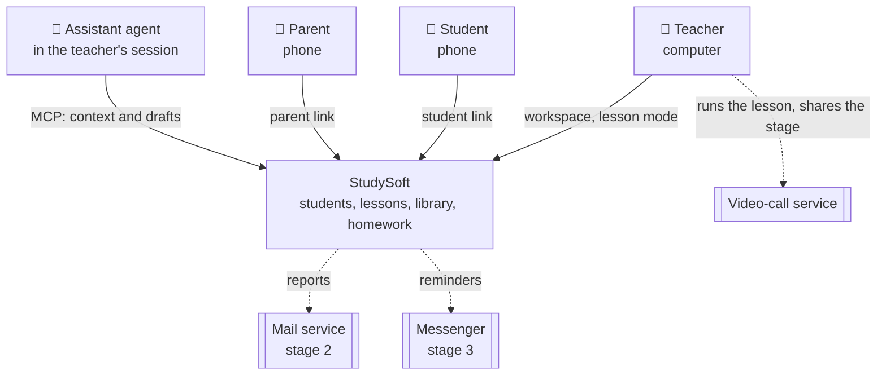
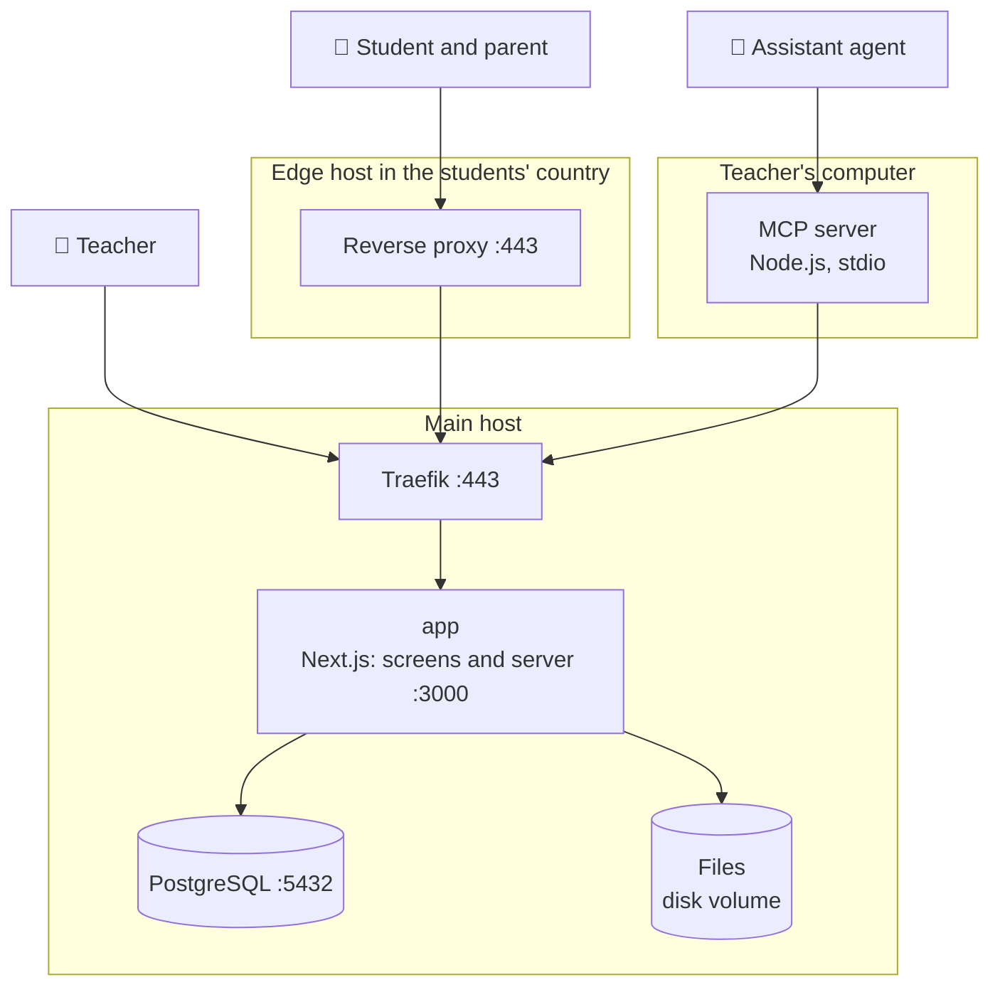
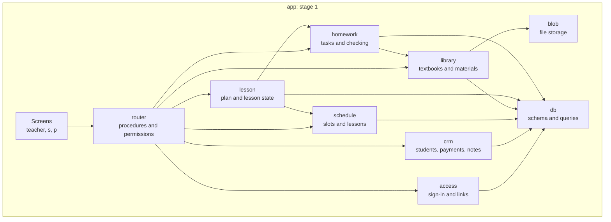
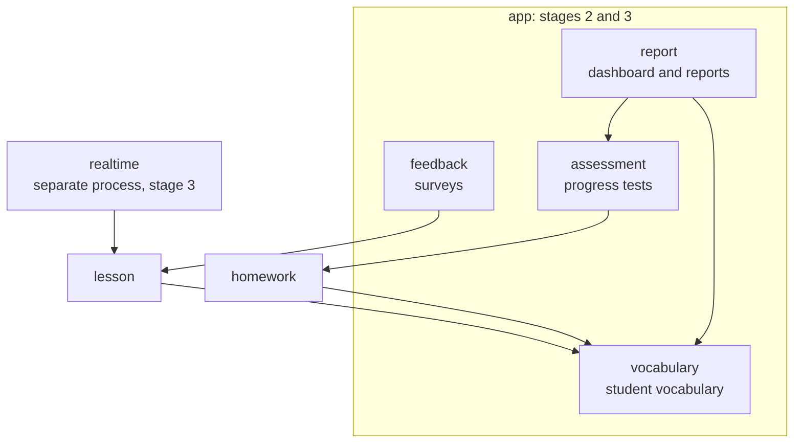
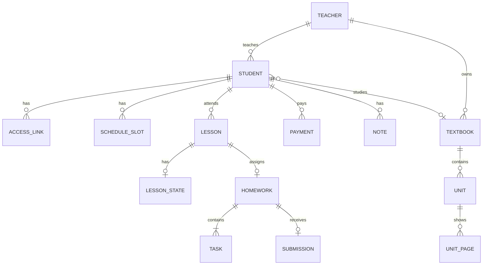
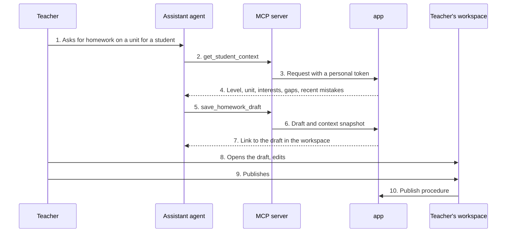
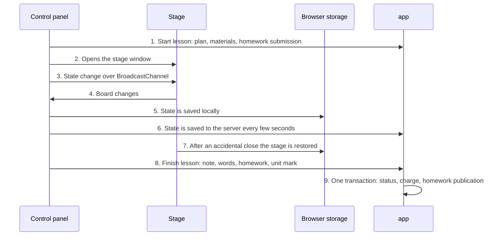
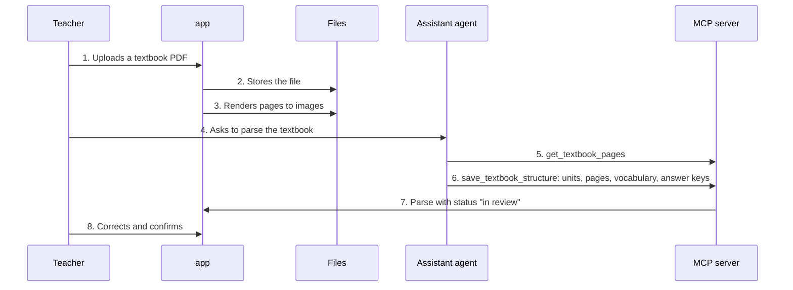
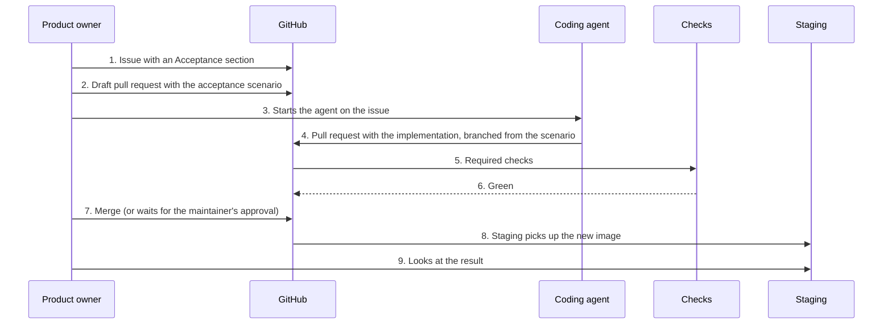
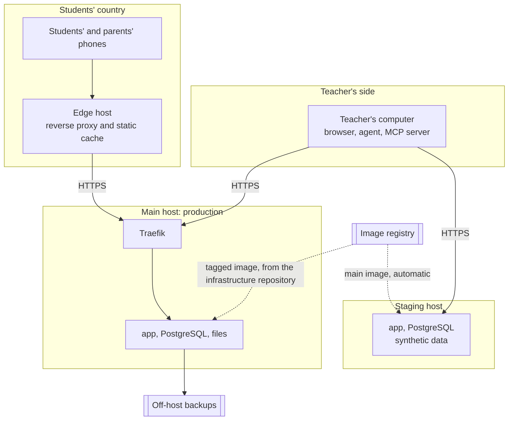

# StudySoft — Architecture

## Overview

StudySoft is a web platform for a private language tutor. It keeps everything around a lesson in one place: students and payments, the schedule, a library of learning materials, a lesson mode, homework with automatic checking, and — in later stages — a personal vocabulary, progress assessments and reports for parents.

The architectural style is a modular monolith in TypeScript: one Next.js application whose screens are separated from the server layer by a typed router, on top of PostgreSQL. AI is not built into the server. Drafts are prepared by an AI agent running in the teacher's own session and handed to the platform through an MCP server.

This document has two readers. One is a person who needs to understand how the system is put together and why. The other is a coding agent that implements tasks and must stay inside these boundaries.

Status: target architecture. The repository holds the foundation; application code arrives in vertical slices. Product requirements will live in `docs/product/`.

---

## 1. Goals

### 1.1 Requirements

**Business:**

- The teacher's time is the lesson. Preparation, homework, checking and reports are semi-automatic: AI prepares a draft, the teacher reviews and edits it.
- Sections are connected. The textbook on a student's card determines lesson materials, homework, vocabulary and assessments. Data is entered once.
- Scale: one teacher and a handful of students now; about ten students and small groups of up to four within a year; several teachers later.
- The code is open, learning content is not. Materials, games, exercises and tests are created by the teacher, alone or with an agent. They are stored as data, not code, and can be exported.
- The product owner should be able to run the project without a developer on call. The development process is therefore as much a part of the architecture as the code.

**Functional, by stage:**

| Stage | Scope |
|-------|-------|
| 1 (core) | Teacher sign-in; student cards, notes, payments, lesson history; schedule with recurring slots and two time zones; library with textbooks split into units; two-window lesson mode with a board; homework with automatic checking behind a student link; access links for the student and the parent (the parent page is a read-only shell until stage 2) |
| 2 | Student vocabulary, assessments, dashboard, teacher overview, parent dashboard and reports, student feedback |
| 3 | Mascots and game elements, messenger notifications, lesson stage behind a student link, shared board, group interface, accounts for other teachers |

**Non-functional:**

- Everything a student or parent opens works from their country without a VPN and without accounts at foreign services.
- Student screens are built for a phone; teacher screens for a computer at 1280 px and wider.
- Switching material on the lesson stage takes no more than 0.5 seconds.
- Time is stored in UTC and shown in the teacher's and the student's time zones.
- Textbook files are available to the teacher only.
- AI output is always saved as a draft and never reaches a student without the teacher's confirmation.

### 1.2 Quality goals

The order is the priority: when goals conflict, the higher row wins.

| Priority | Goal | Measured by |
|----------|------|-------------|
| 1 | **Verifiable changes** | No change reaches `main` without green required checks; the behaviour of every task is pinned by an acceptance scenario |
| 2 | **Protection of children's data** | Tenant isolation and link scope tests pass on every pull request; logs contain no names or tokens |
| 3 | **Availability for students** | A student link opens without a VPN; the first homework screen appears within 3 seconds on mobile data |
| 4 | **Owner autonomy** | Most tasks go from an issue to staging without the maintainer |
| 5 | **Low cost** | No new monthly server bills in the first months |
| 6 | **Room to grow** | Groups, a second teacher and the stage behind a student link are added without reworking the data model |

### 1.3 Stakeholders

| Role | Expects |
|------|---------|
| Product owner (also the teacher, also acceptance) | The platform saves time around the lesson; she runs the backlog, starts the coding agent and accepts work by behaviour |
| Maintainer (architecture, review, operations) | The guardrails hold without constant involvement; approval is needed only for changes in dangerous places |
| Student, 12–15 years old | Opens a link on the phone and does the homework, no registration |
| Parent | Sees the child's progress behind a link, configures nothing |
| Coding agent | Clear rules, a working example to follow, fast feedback from checks |
| Teacher's assistant agent | Reads student context and saves drafts through MCP |

---

## 2. Constraints

### 2.1 Technical

- **Language**: strict TypeScript for everything: screens, server, MCP server, tests. One language is what lets the product owner read the project.
- **Framework**: Next.js and React, dictated by the board, the game-like homework and the lesson mode.
- **Database**: PostgreSQL, one for everything.
- **Client–server boundary**: screens get data only through the typed router. Components have no direct access to the database or server modules.
- **AI**: the server does not call models. Model provider APIs are not available from every region, and a separate API key is a separate cost.
- **Student and parent pages**: no external fonts, analytics or embedded players. Everything a page needs is served from the application's own domain.

### 2.2 Organizational

- **Team**: the product owner writes acceptance scenarios and runs tasks, agents write code, there is one part-time reviewer.
- **The product owner does not read code yet.** Whatever must hold is checked automatically, not by review.
- **The reviewer is stronger on the server than in React.** Complex screens are verified by acceptance scenarios, not by reviewing markup.
- **The repository is public.** It contains no learning content, no student data and no secrets (section 8.9).
- **Tool neutrality**: agent instructions live in `AGENTS.md`; names of specific AI tools do not appear in code or comments. Attribution lines in commits and pull requests are allowed.
- **Whole structure first.** The product owner wants every section to exist in a basic form before any is polished. The architecture answers with vertical slices: each section first appears thin but end to end.

### 2.3 External

- **Personal data**: data about children and parents is personal data. The platform stores the minimum (decision 6 in section 9); legal requirements on where data is stored are met by the deployment.
- **Textbook copyright**: textbook files are visible to the teacher only and have no public links. A student receives only what the teacher included in homework.
- **Characters**: original only, uploaded by the teacher.
- **Video calls**: an external video-call service. The platform stores only the meeting link.
- **Blocking**: foreign services and addresses may be throttled in the students' country without notice. Any third-party dependency of a student page is a risk.

---

## 3. Context and scope

### 3.1 System context (C1)



A solid line is a connection that exists in stage 1. A dashed line is either a connection without integration (the video call) or one that belongs to a later stage.

### 3.2 Technical context

| External party | Protocol | Purpose |
|----------------|----------|---------|
| Teacher's browser | HTTPS | Workspace, lesson mode, file uploads |
| Student's and parent's browser | HTTPS through a reverse proxy in their country | Homework, vocabulary, reports |
| Assistant agent | MCP over stdio to a local program, then HTTPS with a personal token | Reading student context, saving drafts |
| Video-call service | No integration | The teacher pastes the meeting link |
| Mail service (stage 2) | SMTP or HTTP API | Sending a report to a parent |
| Messenger (stage 3) | Bot API | Reminders |
| GitHub | Git, Actions, image registry | Code, checks, image builds |

---

## 4. Solution strategy

### 4.1 Architectural approach

| Approach | Why |
|----------|-----|
| Modular monolith | One teacher and a dozen students do not justify a distributed system. Modules with explicit boundaries give the same order without network calls between them |
| One language | A slice passes through one layer of types from the database to the screen, with no code generation. Agents are most reliable on this stack, and acceptance scenarios are written in the language of the product |
| The router is the only door to data | In Next.js the client–server boundary is blurry: a component can technically read the database. The rule "data only through the router" restores an explicit boundary, and a CI check keeps it |
| Walking skeleton and vertical slices | Agents extend an existing pattern well and invent a consistent one from scratch badly. The first slice goes through every layer: teacher sign-in, a student, a link, a student page, a deployment |
| AI as an external actor | The assistant agent runs on the teacher's side and sees the platform through a narrow set of MCP tools. It creates drafts only; the teacher publishes |
| Content is data | Games, exercises, tests, tasks and the teacher's own method notes live in the database and file storage, not in code. The code can be open without exposing materials, and a new material needs no release |
| Events as explicit commands | Every domain event ("lesson finished", "homework submitted") is one function of a server module in one transaction. The consequences of an event are not scattered across screens |
| Derived values are not stored | Balance, homework completion rate and textbook progress are computed from source records |
| Lesson state is a document | What is on the stage, the page, the player and the board are described by one document that does not depend on how it is delivered. Today it travels over BroadcastChannel, later over WebSocket |
| Acceptance scenarios as the behaviour boundary | The product owner knows how to test. A Playwright scenario is her way to say "it must work like this" and to verify it without a reviewer |

### 4.2 Technology

Libraries marked "candidate" are confirmed when the skeleton is built: the current version and its maintenance are checked first.

| Aspect | Choice | Why |
|--------|--------|-----|
| Language | TypeScript, strict mode | One language for screens, server, MCP and tests |
| Framework | Next.js 16, React 19 | Current stable versions; standalone output gives one small image |
| Server layer | tRPC and zod | Procedure types reach the screen without code generation; input is validated at the boundary; permissions are set per procedure |
| Database access | Drizzle ORM | The schema is described in TypeScript, queries stay close to SQL and are readable in review |
| Migrations | drizzle-kit, SQL files in the repository | A migration is visible to the eye; a migration linter, squawk, catches destructive changes and missing lock timeouts |
| Teacher sign-in | A ready-made library: Better Auth | Authentication code is not written by agents; sessions live in the database |
| Client data | TanStack Query on top of the tRPC client | Caching and retries without hand-written code |
| Styling | Tailwind 4, Radix, Lucide icons | Design tokens map to CSS variables |
| Forms | react-hook-form and zod | The same validation schemas on the client and the server |
| Board | Excalidraw as a candidate | MIT, supports collaboration. Whether it can look like a chalkboard is decided by a spike (section 11) |
| Textbook pages | PDF pages rendered to images on the server with a poppler utility | Deterministic and AI-free; pages open instantly during a lesson |
| MCP server | The official TypeScript SDK, stdio transport | A thin wrapper over the same router; types are shared with the application |
| Acceptance tests | Playwright | Direct successor of Selenium, a model the product owner already knows |
| Unit and integration tests | vitest, real PostgreSQL in Docker | One tool for both levels |
| Packages | npm workspaces | Ships with Node.js: nothing extra to install |
| Build and run | Docker Compose, Makefile | One command in every environment |
| Proxy | Traefik | Already in use on the hosts |
| CI | GitHub Actions | Free for a public repository |

---

## 5. Building blocks

### 5.1 Containers (C2)



Ports are planned values; they become checkable once `deploy/compose.yaml` exists. Only Traefik is published; `app` and PostgreSQL are reachable only inside the internal Docker network.

The application is one container and one image. The teacher and the MCP server talk to the main host directly; students and parents go through a proxy in their country. The reasons are in section 7 and decision 7 in section 9.

### 5.2 Application modules (C3)



Modules of later stages attach to the same points:



Dependency rules:

- Screens talk only to the router. This holds for client and server components alike: a server component calls the same router, so permission checks always run.
- Arrows between modules point down only and go through a module's public functions. A module does not read another module's tables.
- There are no cycles. If a module needs data from a neighbour "upwards", that is a reason to move the event into a function of the upper module.

### 5.3 Responsibilities

| Module | Responsible for | Depends on |
|--------|-----------------|------------|
| Screens | Display and input. No business logic, no data access | `router` |
| `router` | Procedure definitions, input validation, identifying the caller, mapping errors to codes. No business logic | All modules |
| `access` | Teacher sign-in; issuing, checking and revoking student and parent links; personal tokens for MCP; the "who sees what" rule | `db` |
| `crm` | Student card, contacts, statuses, notes, payments, balance, lesson price history | `db` |
| `schedule` | Recurring slots, creating lessons ahead, rescheduling and cancelling, time zones | `db` |
| `library` | Textbooks, files, units, page images, games, warm-ups, videos; textbook parsing and its confirmation; export and import of materials | `blob`, `db` |
| `lesson` | Lesson plan by stages, stage state, the "finish lesson" command with all its consequences | `schedule`, `homework`, `db` |
| `homework` | Homework, task types, draft answers, single attempt, automatic checking, manual review | `library`, `db` |
| `blob` | The `BlobStore` interface: put, read, delete a file. A `file` adapter now, `s3` later | Disk |
| `db` | Schema, migrations and transactions; every query takes the teacher identifier | PostgreSQL |

Repository layout:

```text
app/
  src/app/teacher/     teacher's workspace
  src/app/s/           screens behind a student link
  src/app/p/           screens behind a parent link
  src/app/api/         entry points: router, files, /api/healthz
  src/server/<module>/ server modules from the table above
  src/server/router/   procedures, grouped by who may call them
  src/server/db/       schema and migrations
  src/components/      shared interface components
mcp/                   MCP server and instructions for the assistant agent
e2e/
  acceptance/          acceptance scenarios written by the product owner
  smoke/               smoke checks for a deployed environment
deploy/                compose files, image build, seed data
docs/                  this document
scripts/ci/            guard scripts run by `make check`
AGENTS.md              rules for coding agents
Makefile               single entry point for every command
```

### 5.4 Data model

The core of stage 1.



| Entity | Owning module | Retention | Notes |
|--------|---------------|-----------|-------|
| `teacher` | `access` | Permanent | Account and settings: time zone, cancellation rule |
| `student` | `crm` | Permanent, soft delete | First name with an initial, age, school year, time zone, level, interests, gaps, textbook and current unit. No full name, no phone |
| `contact` | `crm` | Until consent is withdrawn | Parent's email only |
| `access_link` | `access` | Until revoked | Who, role (student or parent), sign-in method, token hash, revocation date |
| `schedule_slot` | `schedule` | Permanent | Weekday, time, time zone, validity dates |
| `lesson` | `schedule` | Permanent | Type, paid or free, time in UTC, status, unit, meeting link, plan by stages |
| `lesson_state` | `lesson` | Until the lesson is finished, then a snapshot | Stage state document with a version number |
| `payment` | `crm` | Permanent | The balance is computed, not stored |
| `price_history`, `level_history` | `crm` | Permanent | History of the lesson price and the level: past charges are never recomputed |
| `note` | `crm` | Permanent | Attached to a student or to a lesson |
| `textbook`, `textbook_file` | `library` | Permanent | Files are visible to the teacher only |
| `unit`, `unit_page`, `vocabulary_item`, `answer_key` | `library` | Permanent | Parsing result; a parse has a status: "in review" or "confirmed" |
| `library_item` | `library` | Permanent, soft delete | Game or trainer (self-contained HTML), warm-up, video, test template, the teacher's method note. Author's content: included in backups and export |
| `homework`, `task` | `homework` | Permanent | Statuses: draft, published, done, not done. Tasks do not change after publishing |
| `submission`, `answer` | `homework` | Permanent; voice recordings per the retention setting | One submission per homework and student, enforced by a database constraint |
| `draft_origin` | `homework`, `lesson`, `library` | With the draft | Who created the draft (agent or teacher) and a snapshot of the student context at generation time |
| `group`, `group_member` | `crm` | Permanent | Tables exist from the first migration; the interface arrives in stage 3 |

Rules for every table:

- Every table except shared reference data has `teacher_id`, and every query filters by it.
- Identifiers are UUIDs: `gen_random_uuid()` by default, the built-in `uuidv7()` where rows are ordered by their identifier. Student page addresses carry no identifiers, only a token.
- Physical deletion is forbidden where history refers to the record.
- Entities of stages 2 and 3 (vocabulary, assessments, reports, surveys, characters) are added by the migrations of their own slices. Only groups and `teacher_id` are created up front: they are the only things expensive to add later.

---

## 6. Runtime view

### 6.1 Key scenarios

#### Scenario: a student does homework

```mermaid
sequenceDiagram
    participant S as Student's phone
    participant R as Reverse proxy
    participant A as app
    participant D as PostgreSQL

    S->>R: 1. Opens the link; the token stays in the fragment
    R->>A: 2. Page and static assets (assets from the proxy cache)
    S->>A: 3. Sends the token in a request body
    A->>D: 4. Finds the link by the token hash
    A-->>S: 5. Session cookie; the page clears the fragment
    S->>A: 6. Current homework
    A-->>S: 7. Tasks without correct answers
    S->>A: 8. Saves each answer after every task
    S->>A: 9. Submits with an idempotency key
    A->>D: 10. Stores the submission and checks it in one transaction
    A-->>S: 11. Count of right and wrong answers
```

Step 7: correct answers never go to the client; checking happens on the server only, and a dedicated test pins this. Step 8 gives a draft of answers if the student closes the page. Step 9: a repeated request with the same key returns the earlier result; a second submission is impossible at the database constraint level.

#### Scenario: the agent prepares a homework draft



Step 4: the context carries the display name only, no contacts. Step 6: the server accepts only the "draft" status from MCP. Step 10 is available only from the teacher's browser session; the agent's personal token has no right to publish.

#### Scenario: a lesson in two windows and its end



Step 3 does not pass through the server, so switching is close to instant. Steps 5–7 make it possible to close and reopen the stage without loss. Step 9 is the `finishLesson` command: either every consequence of "lesson finished" is applied, or none.

#### Scenario: textbook parsing



This flow is provisional. Step 3 is deterministic and needs no agent; it runs in the background and its status is recorded in the database. Steps 5–6 are the riskiest part of stage 1: it is unknown whether an agent copes with scanned pages and how many pages it can read in one session. A spike in the backlog confirms or changes the flow (section 11).

#### Scenario: a task from an issue to staging



Step 2 comes before step 4: a scenario written before the implementation checks the task, not whatever code came out. The scenario pull request is reviewed but never merged on its own, because every scenario in `e2e/acceptance/` runs in `make check` and one without its implementation would keep `main` red. Marking it as an expected failure instead would weaken a check. The implementation pull request carries the scenario commit unchanged and supersedes the scenario pull request. Step 7: if the pull request touches the database schema, access, dependencies, check configuration, CI or deployment, the merge waits for the maintainer (section 8.4).

### 6.2 Behaviour on failure

- **The reverse proxy is down or its address is throttled.** Students cannot open homework; the teacher keeps working because she connects directly. Monitoring probes availability from the students' country. Recovery: move the proxy to another host, one DNS record changes.
- **The main host is down.** Everything is unavailable. The lesson continues in the video call with materials on the teacher's disk. Recovery: restore from the nightly backup on any host with Docker.
- **The stage is closed or the browser crashes mid-lesson.** State is restored from browser storage, or from the last version on the server if that is lost.
- **A student presses "Submit" twice or the connection drops.** The idempotency key returns the first result.
- **The assistant agent sends a bad draft.** The draft is not visible to the student; the teacher edits or deletes it.
- **The assistant agent is unavailable or out of quota.** The teacher creates homework and the plan by hand in the workspace. A manual path is mandatory for every feature that involves AI.
- **Textbook rendering is interrupted by a restart.** The status in the database stays "not finished"; the teacher restarts it with a button.
- **Invalid input.** Validated at the boundary by the zod schema of the router procedure. A server module receives data that is already validated.
- **A migration fails to apply.** The application does not start with a pending migration; the previous version keeps running.

---

## 7. Deployment

### 7.1 Infrastructure



**Two names on one production.** The teacher's workspace and the student pages have different addresses:

| Name | Points to | Used by | Why |
|------|-----------|---------|-----|
| Workspace name | Main host | Teacher, MCP server | Heavy files and the lesson mode do not take a detour through a third country |
| Student name | Edge host | Student, parent | A local address and a short path to the phone |

The link between the hosts is plain HTTPS; tunnels on that route are unreliable.

The proxy caches only static assets with a hash in the name: scripts, styles, fonts. Router responses and student files are not cached and are served with `Cache-Control: private`.

**Delivery.** CI builds the `app` image and pushes it to the registry. Staging polls the registry and updates itself to the image of `main`. Production is pinned to a tag in a separate, private infrastructure repository and is rolled out from there. This repository holds no server secrets.

**Rollback.** Return to the previous image tag. Migrations go forward only and in two steps: first add the new shape, remove the old one in the next release. The previous version of the code therefore works with the next version of the schema.

### 7.2 Environments

| Environment | Purpose | Differences |
|-------------|---------|-------------|
| Local | Development on the product owner's and the reviewer's computers | `make dev` starts PostgreSQL in Docker and the application on the host with hot reload; synthetic data from `deploy/seed`; teacher sign-in with a test password |
| CI | Checks on every pull request | The same compose file; acceptance scenarios run against a production build, against the image once it exists (#4) |
| Staging | The product owner reviews what was merged into `main` | Synthetic data; updates itself |
| Production | Real students | Backups, monitoring, rollout by tag, students enter through the proxy |

### 7.3 Resources

Estimates, not measurements.

| What | Estimate | Limited by |
|------|----------|------------|
| `app` | Up to 400 MB of memory | The Next.js server; PDF rendering runs as a separate process, one page at a time |
| PostgreSQL | Up to 300 MB of memory, under 1 GB of disk in the first year | A dozen students means thousands of rows |
| Files | About 5 GB in the first months, 10–15 GB in a year | A textbook set with audio and video takes 1–2 GB; page images about 0.3 GB per level |
| CPU | Idle | The peak is PDF rendering when a textbook is uploaded |
| Network | Not a constraint | Video goes through the video-call service, not the platform |

A single small virtual server (2 vCPU, 4 GB of memory) runs production with room to spare; it can be shared with other workloads at the start.

**Backups.** Every night a PostgreSQL dump and an archive of files leave the host: students' work and the author's library materials (games, warm-ups, images). Only original textbook files are not backed up: the teacher has them and can upload them again. Restore is verified with `make restore-check`.

---

## 8. Crosscutting concepts

### 8.1 Security and children's data

**Who signs in how:**

| Who | Method | May |
|-----|--------|-----|
| Teacher | Login and password, session in the database | Everything within their own `teacher_id` |
| Assistant agent | Personal token with a limited scope | Read student context and materials, save drafts. Cannot publish, delete, or see payments and contacts |
| Student | Link with a token, exchanged for a session | Current homework, vocabulary, an active assessment. Only their own data and only what is published |
| Parent | A separate link with a token | Read only: the dashboard and sent reports of their child |

Permissions are set by the kind of a router procedure: public, teacher, student, parent or agent. A procedure without a kind cannot be created. Reachable without a session are exactly: teacher sign-in and sign-out, the exchange of a token for a session, and the health check. Sign-in and sign-out are the authentication library's own endpoints under `/api/auth/`; `src/server/access/auth.ts` lets through only those two and answers 404 to everything else the library offers. The health check is a public procedure that reveals only whether the database answers and the build SHA. Adding anything to this list changes a guarded path.

**Links with a token:**

- A token is 256 random bits. The database stores only its hash.
- The token travels in the URL fragment (`/s#<token>`). Browsers never send the fragment to a server, so the token does not reach the access logs of the edge proxy or Traefik.
- On first open the page script sends the token in a request body to the exchange procedure, receives a session cookie and clears the fragment, so the token does not linger in history and screenshots.
- Reissuing a link revokes the previous one immediately.
- A revoked, a foreign and a non-existent token produce the same response.
- Token exchange attempts are limited by the application per client address, so the limit holds whichever host a request comes through. Behind the edge proxy the address is taken from the forwarded header of that trusted proxy only.
- Access is stored as a record of "who, role, sign-in method". A password for a student or a parent can later be added as one more sign-in method for the same person without changing the rest of the model.

**Tenant isolation.** The teacher identifier comes from the session, never from the request. Functions of the `db` module take it as a mandatory parameter. An integration test creates two teachers and checks every procedure.

**What goes to the client.** There is no separate contract file; the input and output schemas of procedures play that role. The output schema is mandatory: the linter rejects a procedure without one, so a database row cannot be returned as is. Correct homework answers, teacher notes, payments and contacts never appear in responses for students and parents; each such boundary has a test.

**Files.** There are no direct links to files: the application serves each file after checking permissions. A textbook is available to the teacher only; a student receives only attachments of their own published homework.

**Games.** A game is an HTML file generated by AI, which makes it untrusted code. It opens in a frame with the `sandbox` attribute, without access to the platform's origin, and is served with the `Content-Security-Policy: sandbox` header. A game cannot see cookies and cannot call the router.

**Dependencies.** npm packages are an attack surface of their own. Versions are pinned by the lockfile, CI installs strictly from it, adding a dependency needs the reviewer's approval, updates arrive as automated pull requests.

**Data minimisation:**

| Stored | Not stored |
|--------|-----------|
| First name with an initial, age, school year, time zone | Full name, date of birth, address, phone |
| Parent's email, if they agree to receive reports | Messenger handles of students and parents in stages 1 and 2 |
| Voice answers, with a retention period from settings | Photos and videos of the child in the profile |
| Teacher's notes | — |

**Logs and secrets.** Logs carry internal identifiers only; names, tokens and answer contents never appear there. Secrets live outside this repository, in the deployment's own secret store and in the server's environment. Their absence here is checked on every pull request.

**Parental consent.** The wording and the way it is collected are defined by the teacher before the first real student is added. The consent names the video-call service too: the child's video is processed by a third party.

### 8.2 Observability

- **Logs**: structured JSON to the container's stdout; every request has its own identifier.
- **Health check**: `/api/healthz` returns the database state and the build SHA. The SHA proves that staging has updated.
- **Monitoring**: the production `/api/healthz` is probed by external monitoring with an alert to a messenger. A separate probe opens a student page from the students' country.
- **Metrics and tracing**: not introduced in stage 1. With a dozen users logs are enough.

### 8.3 Error handling

- **Codes**: domain errors are mapped to router codes in one place. "Not found or not allowed" is `NOT_FOUND`, "invalid input" is `BAD_REQUEST`, "the state does not allow it" is `PRECONDITION_FAILED`, "not signed in" is `UNAUTHORIZED`.
- **Not allowed and not found** are indistinguishable to the client.
- **Idempotency**: commands with an irreversible effect (submitting homework, finishing a lesson, recording a payment) take an idempotency key.
- **Retries**: the client retries only reads and idempotent commands.
- **The server makes no external calls in stage 1**, so circuit breakers and queues are not needed. They arrive together with mail and messenger notifications.

### 8.4 Guardrails for agents and the merge process

The main rule: whatever must hold is checked by a machine. `AGENTS.md` tells an agent how to work; CI refuses to merge what breaks the rules.

**Required checks on every pull request.** Checks marked "now" run already; the rest arrive with later slices.

| Check | Catches | State |
|-------|---------|-------|
| `forbidden-files` | Documents, audio, video, archives, dumps, env files, oversized files; raster images outside `app/public`; test data outside `deploy/seed` | Now |
| `acceptance-unchanged` | A pull request edits or deletes an existing acceptance scenario together with code. Adding new ones is allowed | Now |
| `secrets` | Keys, passwords and tokens in changes | Now |
| `lint-docs` | Broken Markdown | Now |
| `typecheck` | Type errors in every package, including drift between the MCP server and the router | Now |
| `lint` | Style and common mistakes; server actions | Now |
| `unit` | Unit tests | Now |
| `integration` | Tests against real PostgreSQL, including tenant isolation, link scope and the shape of responses for students | Now |
| `migrations` | Schema in code and migrations match; the linter (squawk) catches locking and destructive changes | Linter now; schema drift with #2 |
| `acceptance` | Playwright acceptance scenarios against a production build; against the image once it exists (#4) | Now |
| `server-boundary` | Access to server modules bypassing the router; server actions in components; entry points outside `src/app/api/` | With the skeleton |
| `output-schema` | A procedure without an output schema | With the skeleton |
| `module-boundaries` | Importing the internals of another server module | With the skeleton |
| `dependencies` | Known vulnerabilities in packages; an install that does not follow the lockfile | With the skeleton |

**Who merges:**

| Paths | Whose approval is needed |
|-------|--------------------------|
| `app/src/server/db/` (schema and migrations), `app/src/server/access/`, base procedures, public, student, parent and agent procedures, entry points in `app/src/app/api/` and request gating (`app/src/middleware.*`, `app/src/proxy.*`), the MCP server (`mcp/`), Next.js configuration (`next.config.*`), `package.json` and the lockfile, linter and TypeScript configuration, test runner configuration (`playwright.config.*`, `vitest.config.*`), migration tool configuration (`drizzle.config.*`), secret-scan configuration (`.gitleaks.toml`, `.gitleaksignore`), `.github/`, `scripts/ci/`, `deploy/`, `Makefile`, `AGENTS.md`, `docs/architecture.md` | The reviewer's (CODEOWNERS). The product owner is a second code owner only to approve the reviewer's own pull requests, because GitHub does not let authors approve themselves |
| Everything else: screens, styles, texts, teacher-side procedures and module logic on the existing schema | The product owner merges once checks are green |

Direct pushes to `main` are forbidden for everyone, the owner included. The branch ruleset enforces this: required checks, a pull request for every change, code-owner approval for guarded paths, and no bypass. A ruleset cannot require a particular code owner, so "the owner approves only the reviewer's pull requests" is a convention, not a check.

**What a task looks like.** The issue template requires three sections: what and why; acceptance (steps that become a Playwright scenario); out of scope. A task without acceptance is not started. The size of a task is one vertical slice that can be shown on staging.

**How a coding agent works.** It reads `AGENTS.md` and this document; finds the nearest existing slice and repeats its layout; changes the schema, then the server module and the procedure, then the screen; runs `make check` locally before pushing. `make check` runs the same set as CI. The agent never moves learning content into code, tests or seed data (section 8.9).

### 8.5 Testing

| Level | Verifies | Written by |
|-------|----------|-----------|
| Unit | Pure logic: answer checking with normalisation, balance, creating lessons from slots, time zones | The agent, together with the code |
| Integration | Database queries, event transactions, isolation, link permissions, response shapes | The agent; the reviewer checks the set for the `access` module |
| Acceptance | Behaviour as a user sees it | The product owner |
| Smoke | An environment is alive after a rollout and serves the expected version | The reviewer, once |

Test data is synthetic only and lives in `deploy/seed`. It is written for this repository: it is neither the teacher's material nor an excerpt from a textbook. Real students never appear in tests or on staging.

### 8.6 Time and time zones

Time is stored in UTC. A recurring slot stores local time and the student's time zone, not a moment in UTC: when clocks change, the lesson stays "Tuesday at 17:00" for the student. A concrete lesson stores a moment in UTC. Showing two time zones is the screen's job; the server returns the moment and both zone names.

### 8.7 Interface

- Design tokens are CSS variables in one file. Student screens use accent variables, so a student's colour theme is applied without changing components.
- Fonts are served from the application's own domain.
- The interface is in Russian only; strings are not moved to dictionaries until there is a second language.
- The teacher's workspace, student screens and parent screens are three separate route trees with their own layouts. They share only base components.

### 8.8 Working with AI

- **One student context.** One function on the server collects everything a generation reads: level, unit, interests, gaps, mistakes from recent homework. The MCP tool `get_student_context` is a wrapper over it.
- **Drafts only.** Any MCP tool that writes creates a record with the "draft" status, marked as authored by an agent, with a snapshot of the context.
- **A manual path is mandatory.** Whatever an agent prepares, the teacher can do by hand in the workspace.
- **Instructions for the assistant** come in two parts. The description of formats and tools (which task types exist, how to save a draft) is code: it lives in `mcp/assistant/` and is versioned with the router. The teacher's method (how she composes homework, her templates and techniques) is content: it is stored in the library as a method note and read by the agent through MCP.
- **Moving to the server.** If a "generate" button without an agent is ever needed, a server-side model call uses the same context function and the same path for saving a draft. Only the caller changes.

### 8.9 Code and content

The code of the platform is open; learning content is closed. The boundary:

| Code: in the repository, open | Content: in the database and files, owned by the teacher |
|---|---|
| Screens, server modules, MCP server, tests | Textbooks and the result of parsing them |
| Task types and their automatic checking | The tasks themselves, homework, tests and assessments |
| The shell for games: frame, colour theme hand-over | Games and trainers — self-contained HTML files |
| The description of formats and tools for the assistant agent | The teacher's method notes: report template, her own instructions for the assistant |
| Synthetic data for staging | Warm-ups, videos, characters, students' vocabularies |

**How content appears.** The teacher uploads a file in the workspace or asks the assistant agent. The agent reads existing materials and student context through MCP and saves the result as a draft. A new game, trainer or test needs no code change and no release.

**Export.** Any material can be exported from the workspace in its original form: a game as an HTML file, a task set as a JSON file. The whole library is exported as one archive: a manifest file and directories by material type. The same archive can be imported back, into this installation or another one. Original textbook files are not included by default. The archive format is described in the repository and has a version number.

The archive is easy to keep in a private folder or a private git repository, which gives materials an edit history without version support in the platform itself. Because the assistant agent reads materials through MCP, it can also save a copy to the teacher's local folder right when a material is created.

**What never enters the repository.** The teacher's materials, textbook excerpts, characters, real student data. The `forbidden-files` check catches files by type and size but not text. All test data therefore lives in one guarded directory, `deploy/seed`, and the rule is repeated in `AGENTS.md`.

**Games in stage 1.** A game receives only the colour theme from the shell. Returning a result from a game to homework (so that a trainer can award points) needs a message protocol between the game and the shell; that is a separate decision for later.

**License.** The code is under the MIT license. Content is not covered by the code's license.

---

## 9. Architecture decisions

All accepted on 2026-11-11. A decision is changed by editing its row in a pull request that says why.

| # | Decision | Why | Accepted cost | Rejected |
|---|----------|-----|---------------|----------|
| 1 | One language: a Next.js application in TypeScript, server code in `src/server` behind a tRPC router. Procedure schemas are the contract; there is no separate contract file | Complexity sits in the screens, the server is thin. One layer of types from database to screen, no code generation, one image. Scenarios are written in the language of the product | The client–server boundary in Next.js is blurry and is held by rules and checks. A client in another language gets no help from the types. npm is a large attack surface | A separate backend in another language with a schema-first contract: two languages and code generation in every slice, with no external consumers |
| 2 | One repository for the application, the MCP server, tests and deployment files | They change together; the MCP server uses the router's types directly | CI is longer; acceptance tests run on every pull request | Separate repositories: a coordinated change is spread over several pull requests |
| 3 | AI works through MCP in the teacher's session; the server calls no model | No API key, worker or queue; the server can be hosted anywhere; "drafts only" is enforced on the server | Generation starts from the agent's window, not a button. A teacher without an agent cannot use it | Model calls from the server: revisit when a second teacher arrives (section 8.8) |
| 4 | Students and parents sign in with a token link | Teenagers will not get past a login screen to homework; less personal data | The link is the key; mitigated by reissue and by exchanging the token for a session | Passwords: recovery, weak passwords and attempt limiting for no better protection. Revisit in stage 3 |
| 5 | Teacher sign-in through a ready-made authentication library (candidate: Better Auth) | Password hashing, sessions and brute-force protection are not written by agents | A third-party dependency in the most sensitive place | Hand-written sign-in; a separate authentication service |
| 6 | Store the minimum of personal data; where data is hosted is a deployment decision | A leak exposes little; moving to another country changes no code | The student card is poorer than the requirements ask for; data-residency law is met by whoever deploys | A full card with contacts |
| 7 | Students enter through a reverse proxy in their country; the teacher and MCP connect to the main host directly | A local address for students without moving data; a blocked proxy does not stop the teacher | One more point of failure for students; two places to configure TLS | One name on the main host; a tunnel between hosts |
| 8 | Files on the server disk behind the `BlobStore` interface | No cost and no external dependency for 10–15 GB; S3 later is a second adapter | The disk is shared and must be watched; large files pass through the application | S3 from day one |
| 9 | Lesson state is one versioned document; BroadcastChannel carries it now, a small Node.js relay over WebSocket in stage 3 | Stage 1 needs no real-time server; changing the transport does not touch the stage or the control panel | The change format must be designed before stage 3 | A real-time server from day one; a separate language for the relay |
| 10 | Acceptance scenarios, written before the implementation, define behaviour; merge rights depend on the path | Work is accepted by behaviour without a reviewer; an agent cannot weaken its own checks | Scenarios must be maintained; schema changes still wait for the reviewer | Everything through the reviewer; everything at the owner's discretion |
| 11 | CI builds an image; staging pulls `main` on its own; production is pinned to a tag in a private infrastructure repository | The public repository holds no access to servers | A production rollout needs whoever manages the servers | Rollout over SSH from CI |
| 12 | The code is open; learning content is stored only as data and exported as an archive in an open format | The code is published without exposing materials; a new material needs no release; the teacher keeps a copy | The archive format must stay compatible; games are untrusted HTML; content passes no review | Materials in the repository; a private content repository pulled in at build time |

---

## 10. Quality requirements

| Quality | Scenario | Metric | Status |
|---------|----------|--------|--------|
| Verifiability | A pull request adds a document or an env file | The check is red | Implemented |
| Verifiability | A pull request changes an existing acceptance scenario together with code | The check is red | Implemented |
| Verifiability | A pull request with a failing test | Merge is blocked | Planned |
| Verifiability | A component reads the database bypassing the router | The check is red | Planned |
| Data protection | Teacher A requests a student of teacher B | "Not found", same as for a non-existent one | Planned |
| Data protection | A student link is reissued | The old link stops working immediately | Planned |
| Data protection | An agent saves a homework draft | It is not visible behind the student link until published | Planned |
| Data protection | A student requests homework | The response contains no correct answers | Planned |
| Data protection | A procedure without an output schema | The check is red | Planned |
| Portability | The library is exported and imported into an empty installation | The set of materials matches | Planned |
| Availability | A student opens the link on a phone without a VPN | The page opens; a probe from the students' country returns 200 | Planned |
| Speed | First homework screen on mobile data | Under 3 seconds | Planned |
| Speed | A click on a material in the control panel | The stage changes within 0.5 seconds | Planned |
| Reliability | The stage window is closed and reopened | The board and the current material are in place | Planned |
| Reliability | Homework is submitted twice | One submission, the same result | Planned |
| Reliability | The server disk is lost | Restore from the nightly backup, at most a day lost | Planned |
| Developer experience | A clean macOS machine | `make dev` brings the stand up with one command | Planned |
| Developer experience | A merge into `main` | The change is on staging within 10 minutes | Planned |

---

## 11. Risks and technical debt

### 11.1 Risks

| Risk | Probability | Impact | What we do |
|------|-------------|--------|-----------|
| Textbook parsing by an agent gives unusable results: scans, hundreds of pages, answer keys from the teacher's book | High | High: lessons, homework and vocabulary all stand on the parse | The first backlog task is a spike on one real textbook. Fallback: the teacher enters page ranges for units by hand; the rest is added later |
| The size of the requirements against "build everything at once": dozens of slices before the first benefit | High | High: the project eats time needed for students | The backlog is ordered by the teacher's pains, not by sections. The first benefit is homework behind a link |
| Learning content reaches the open repository through test data: an agent copies textbook text or the teacher's material into a test | Medium | High: git history cannot be cleaned | All test data in the guarded `deploy/seed`; the rule in `AGENTS.md`; the product owner knows it and watches her own scenarios |
| An agent bypasses the client–server boundary: sends too much to the client or reads the database from a component | Medium | High: leaked homework answers or another tenant's data | The `server-boundary` check; an explicit output schema on every procedure; tests on response shapes for students and parents |
| Complex screens (lesson mode, board, game-like homework) have no expert reviewer | High | Medium | Ready-made components; linter rules; acceptance scenarios instead of markup review |
| The reviewer is a bottleneck: in stage 1 many tasks change the database schema | Medium | Medium | The schema for stage 1 slices is designed as a batch in advance; such pull requests are reviewed first |
| A vulnerable or hijacked npm package | Low | High | Lockfile, installs strictly from it, reviewer approval for new dependencies, automated update pull requests |
| The address of the edge host is throttled or blocked | Medium | High for students | A probe from the students' country; moving the proxy to another host within an hour |
| The chosen deployment does not meet legal requirements on where personal data is stored | Low with a handful of students | Medium | Minimisation, parental consent; moving the database and files to the required country is a deployment task and changes no code |
| The agent subscription quota is not enough for development and content generation at once | Medium | Medium | Small slices; a manual path for every feature with AI |
| The student cannot hear a track when the stage window is shared in the video call | Medium | Medium | Verify in practice before building the lesson mode: share a tab with sound or a window |
| Voice recording on iOS Safari yields a different format than Chrome | Medium | Low | Store as is together with the media type; verify playback on the teacher's side; transcoding later |
| Excalidraw cannot look like the chalkboard in the design | Medium | Low | A spike; fallback is a simple canvas board of our own |
| Production runs on infrastructure managed by one person | Low | High if that person is unavailable | Everything is described as code; restore on any server from a backup and a compose file; a recovery guide in `docs/` |

### 11.2 Technical debt

Deliberate simplifications of the start. Each gets an issue at the moment the corresponding code lands.

#### Debt 1: files on the server disk

- **Simplified**: a directory on disk instead of object storage.
- **Cost**: the disk is shared with other workloads; large files pass through the application.
- **When to fix**: above 15 GB, or when moving to a dedicated server.

#### Debt 2: generation through an agent only

- **Simplified**: no server-side model call and no "generate" button.
- **Cost**: only a teacher with a configured agent can use the feature.
- **When to fix**: before a second teacher arrives.

#### Debt 3: textbooks are not in backups

- **Simplified**: the database, students' work and the author's materials are backed up; original textbook files are not.
- **Cost**: after a disk loss textbooks must be uploaded and parsed again.
- **When to fix**: when parsing a textbook starts to take a noticeable amount of the teacher's time.

#### Debt 4: production shares a server

- **Simplified**: no dedicated server.
- **Cost**: shared memory, disk and maintenance windows.
- **When to fix**: when operations change hands or resources run short.

#### Debt 5: large uploads without resume

- **Simplified**: a PDF of hundreds of megabytes is uploaded in one request.
- **Cost**: a dropped connection means uploading again.
- **When to fix**: at the first complaint; the fix is chunked upload.

#### Debt 6: background work without a queue

- **Simplified**: textbook rendering runs as a background process of the application; its status is in the database.
- **Cost**: an application restart interrupts rendering and it must be started again.
- **When to fix**: when a second background job appears (mail, reminders); the fix is a queue in PostgreSQL.

---

## 12. Glossary

| Term | Meaning |
|------|---------|
| Stage | The lesson-mode window the teacher shares with the student: materials and the board |
| Control panel | The lesson-mode window only the teacher sees: plan, notes, control of the stage |
| Lesson state | A document describing what is on the stage now: step, page, player, board |
| Unit | A section of a textbook; a student always has a current unit |
| Gaps | Topics a student needs to catch up on; maintained by the teacher |
| Assessment | A monthly test by skill, with a result in percent |
| Token link | A permanent personal address of a student or a parent with a secret part; it replaces a login |
| Draft | A record created by an agent or the teacher and invisible to the student until published |
| Coding agent | An AI tool that writes code for an issue |
| Assistant agent | An AI tool in the teacher's session that prepares learning content through MCP |
| MCP | A protocol through which an agent calls the tools of an external system |
| Router | The set of typed server procedures; the only way screens and the MCP server read and change data |
| Procedure | One server operation of the router, with a description of its input, its output and who may call it |
| Vertical slice | A small feature implemented through every layer, from the screen to the database |
| Acceptance scenario | An automated test that repeats a user's actions in a browser and checks the result |
| Content | Learning materials: textbooks, tasks, games, trainers, tests, method notes. Stored as data, never in the repository |
| Export | An archive of the library in an open format that the teacher keeps and can import back |
| Staging | A copy of the platform with synthetic data that receives everything merged into `main` |
| Production | The running platform with real students |
| Reverse proxy | A server that accepts requests and passes them on to another server |
| ADR | An architecture decision record: context, choice, consequences |

---

## Document metadata

- **Version**: 0.5
- **Last updated**: 2026-11-11
- **Owner**: Viktoriia Komarova
- **Status**: Draft — target architecture, ahead of application code
